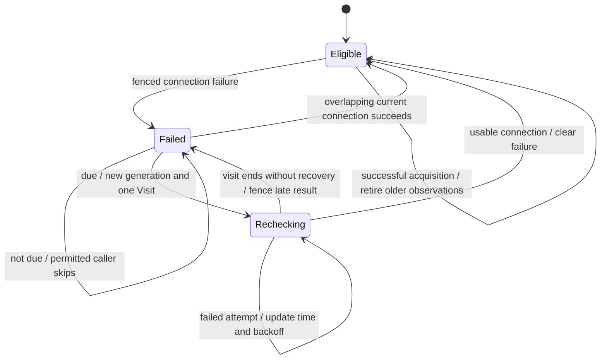
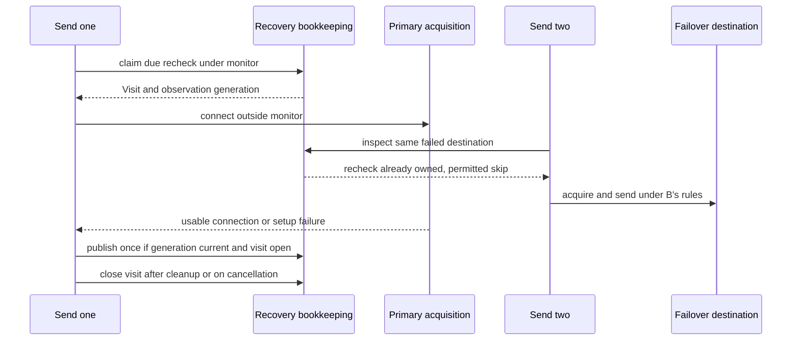

# 10 — Connection failover and recovery

[Catalogue](README.md) · [Architecture](../failover/architecture.md) · [Send operation](01-send-operation.md) · [Lifecycle](02-mailer-lifecycle.md) · [Sending limits](09-sending-limits.md)

This mechanism lets an operation use another approved SMTP destination after a connection failure without creating another send operation or replaying a submission.

## Ownership and entry points

`MailerImpl.executeEmailSend` runs on executor execution for async sends and on the caller for sync sends. `MailConnectionRoute` captures finite cluster candidates, applies each stage's policy and follows its explicit next Mailer. It never invokes another Mailer's public sending API. Each candidate prepares the original Email using its owner's templates and all applicable message locks.

`FactoryMailerRuntime.Definition` owns connection observations and named identity, separate from immutable configuration. `ConnectionRecovery` protects only observations, their generation and recheck ownership. `DestinationConnectionObserver` translates those observations into duplicate-suppressed logs. `AcquiredMailTransport` owns the successful connection, including exceptional cleanup.

## Derived states and transitions

These are explanatory states derived from `latestFailure` and the current generation's recheck owner, not another enum or public health model.

An ineligible policy does not gain permission from a permissive caller. While the failed destination is awaiting recheck, it fails with cached evidence rather than silently moving to another destination. Once due, that stricter caller may try the original destination again; retrying its authentication is not permission to bypass it.

## Monitors and fences

| State/resource | Protection | Work explicitly outside the monitor |
| --- | --- | --- |
| Failure, monotonic timestamp, count, observation generation, active recheck | `ConnectionRecovery` monitor | Connection acquisition, waiting, proxy work, cleanup, logging and callbacks |
| Captured registrations and route history | Operation's executing path | No global route monitor; pinned selection preserves registration identity |
| Delegated participant use | Existing `MailSendOperations` lifecycle monitor | Route work executes after admission; no delegation to the participant's executor/observer |
| Stop actions | Existing `MailSendControl` registration fences | Recheck ownership is released by an idempotent stop registration |
| Background allocation permission | Generic pool's opt-in allocator gate consults the observation | Refusal defers replenishment before reserving capacity; it is not an allocation error |

An observation captures its generation and the recheck visit belonging to that generation, if any. It can publish once, while that generation remains current and its visit remains open. Failure leaves the generation open so a connection already in flight can still demonstrate recovery. Success advances the generation, retiring overlapping failures. Starting a deliberate due recheck also advances the generation: pending results from an earlier connection window cannot replace its findings. Cancellation closes the owning visit regardless of how many retries it made.

Recovery and the routing scope's lifetime are separate. A successful recheck's send may still be running, but that old visit no longer owns new observations or blocks a new incident's due recheck. Closing it cannot retire a replacement visit. A successful setup resets connection preference, not sending allowance. Healthy connected leases can also supply usable-connection evidence.

### Publication rules

| Event under the recovery monitor | State change | Effect on other observations |
| --- | --- | --- |
| Current observation fails | Record failure and time; advance backoff at most once per recheck visit | Keep its generation open for a concurrent success |
| Current observation succeeds | Clear failure/backoff and advance generation | Ignore older results, including late failures |
| One caller starts a due recheck | Advance generation and assign its visit | Retire earlier connection work; other permitted callers can use failover |
| Owning visit closes or is cancelled | Fence unfinished observations from that visit | Do not affect a newer generation or replacement visit |
| Completed, closed-owner or old-generation observation reports | No change | Never resurrect an incident or clear a newer failure |

This is a small internal state machine, not a general rules engine. Generation controls which connection window may publish; visit lifetime controls cancellation. They must not be collapsed into a revision incremented by every result: doing so lets one failed connection discard its concurrent peer's valid success.

Backoff advances once per failed recheck visit, not once per physical connection attempt. Immediate retries in the initial visit therefore leave the first recheck interval unchanged; retries within a recheck cannot skip later backoff steps. Accepted failures still update the timestamp, so the interval starts at the latest failed attempt. Recovery resets this count. Ordinary Mailers outside a configured failover route keep background replenishment enabled after failures.

Normal pool-capacity waiting and rate-limit waiting never mark an outage or select a failover destination. Failed acquisition must finish disposal, release unused allowance and retire stop registrations before another candidate starts. A suppressed cleanup failure stops routing rather than claiming successful disposal.

`ConnectionSetupFailure` is internal routing evidence but also a `MailException`. When no route is configured, or its policy forbids continuation, callers can still catch the documented public exception family. The observer and asynchronous completion retain that same failure instance; connection setup does not manufacture a submission receipt.

## Retained scopes and shutdown

`FailoverSharedSends` preserves one lazy iterator. Between completed email/observer boundaries it may acquire a recovered earlier destination before releasing its current eligible connection. A failed recheck may retain the current one. `withOpenConnection` resolves the initial destination and then stays pinned; its application callback runs once.

With failover configured and the batch module available, these scopes retain a selected pool lease and count against capacity until release/invalidation. Without that module, they own a direct connection. Without failover, the existing simple-batch/callback path remains dedicated and non-pooled. Application work, rate waits and inline observers can therefore keep a failover scope's lease occupied; a nested send cannot borrow from the same exhausted pool until the scope releases it.

Connection wrappers are execution-confined, not independently thread-safe: only the owning execution sends and closes them. `ScopedMailSender` checks callback-thread identity before accessing its active flag or invoking the delegate. It rejects cross-thread use, and its `finally`-managed scope ends before connection cleanup, including when the callback throws. Both ordinary and failover callbacks use this guard. Cancellation can abort the underlying socket concurrently; it does not invoke wrapper cleanup or release a lease. No monitor spans the send or callback to enforce this boundary.

A retained transport remembers send failures to decide whether its lease needs invalidation. That is separate from exception propagation: if a callback catches a send failure and returns normally, a later cleanup failure still fails the scope. If an exception escapes the callback, try-with-resources preserves it and attaches cleanup failure to that escaping exception, not to a previously handled send failure.

Participants admit delegated use through existing lifecycle scopes. The same-thread execution-owner stack includes delegated owners so closing a participant from its own callback fails rather than waiting on itself. Borrowed Mailers are not closed by the initiator; privately constructed named Mailers are. No monitor spans application callbacks or another Mailer's drain.

## Evidence and limits

- `SelectedMailerPreparationTest` controls A-only invocation selecting B, selected templates and executor preparation.
- `ConnectionRecoveryTest.onlyOneDueRecheckRunsAndItsCancellationFencesLateResults` uses a deterministic clock and stale observation, not timing thresholds.
- Its multi-attempt cancellation regressions verify that late success and late failure cannot overwrite a replacement recheck after an earlier retry failed.
- Recovery-transition tests cover both start and completion orders for overlapping success/failure, once-only publication, deliberate recheck generations and work begun after successful recovery. An old successful visit must not own later observations or block the next incident's recheck.
- Real asynchronous direct sends reproduce overlapping refusal/success and assert primary preference is restored in both completion orders, with and without diagnostics.
- Public-boundary tests cover `MailException` and exact observer/completion identity for sync/async, direct/pooled, ordinary sends and policy-disallowed failover. Retained-scope tests compare dedicated close with healthy lease reuse for batches and callbacks.
- Recovery tests count one backoff step per failed recheck visit, preserve the initial interval across immediate retries, and reset after success. Direct and pooled sends exercise the same schedule through the actual route.
- Builder-level tests cover absent, cleared and nested failover relationships. The real-pool regression observes background replacement after a setup failure before submitting any email; the configured-route counterpart requires an operation-led recheck before background replenishment resumes.
- `ConnectionFailoverTest.aDueRecheckDoesNotHoldOtherSendsAwayFromTheWorkingDestination` holds acquisition at a barrier while another send continues through the working destination.
- `ConnectionFailoverTest.ordinaryPoolCapacityTimeoutIsNotAFailoverIncident` holds a lease and checks that saturation does not contact the alternative.
- `ConnectionFailoverTest.lazyBatchReturnsToRecoveredPrimaryOnlyBetweenEmails` advances a controlled clock between messages; one iterator and one outcome per email are retained.
- `ScopedMailSenderTest` checks both send methods, receipt identity, owner-thread access and scope expiry. `ConnectionFailoverTest.openConnectionRejectsForeignAndEscapedSenderCallsBeforeAnySendWork` checks ordinary and failover callbacks, including invalidation before physical cleanup; its throwing-callback regression preserves the original exception.
- The retained-callback cleanup regressions cover direct and pooled failover, caught send failures followed by normal return or another send, and cleanup suppression on the exact escaping callback/send exception.
- `SmtpConnectionFailoverWireTest` uses local SMTP sockets for greeting loss, temporary setup rejection and mandatory-STARTTLS stopping.
- Upstream `BackgroundAllocationGateTest` and `ConnectionObservationTest` exercise the unpublished local hook changes. Their release gate remains separate.

These controlled interleavings are not a proof against every application/provider deadlock. Full verification results belong in the implementation plan, not inferred from these diagrams.

## Infographic review

The shared [resource-layer infographic](inside-a-mail-send.md) remains accurate at its level: one entry/operation, existing executor, selected transport and once-only observation. Failover coordinates destination selection; it adds no send executor or message replay layer. Its entry-point companion table now says preparation occurs during executor execution. No replacement raster was generated.
