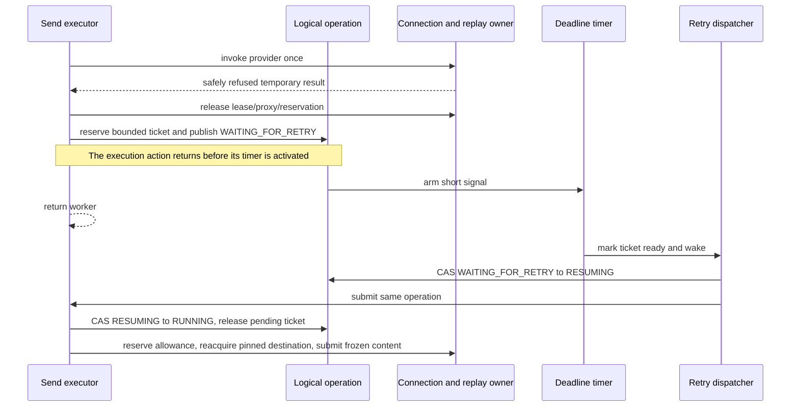

# Safe mail-send retries

This parks a refused email without holding an ordinary send worker or connection, then gives exactly one execution path ownership of its next attempt.

[Catalogue](README.md) · [Send operation](01-send-operation.md) · [Lifecycle](02-mailer-lifecycle.md) · [ADR 0030](../adr/0030-safe-bounded-mail-send-retries.md)

## Owners and boundaries

| Owner | State and responsibility |
| --- | --- |
| `MailSendRetryingSubmission` | One selected destination, frozen replay, invocation count and last genuine failure; never reselects or governs the email again. |
| `MailSendOperation` | CAS transitions between execution, waiting, resumption and terminal reporting. |
| `MailSendRetryCoordinator` | Bounded pending tickets; one short bookkeeping monitor protects pending/ready sets and timer ownership. |
| `MailSendReplayBudget` | Short synchronized aggregate-byte accounting. Individual reservations are execution/terminal-path confined. |
| Initiating `MailSendOperations` | Lifetime, executor, shared deadline worker, lazy retry dispatcher, completion worker, replay and waiting bounds. |
| Selected Mailer | Retry schedule from its policy, SMTP configuration, templates, security and sending allowance. |

`MailSendRetryPolicy` groups schedule and resource settings for configuration, not mutable coordination. The initiator uses its own
policy's resource limits, even when a different selected Mailer supplies the retry schedule. A resource-only policy remains disabled
for its own submissions. Defaults are centralized on `MailerGenericBuilder`; runtime trackers remain attempt/Mailer-owned as above.

No bookkeeping monitor covers executor admission, MIME reads, SMTP work, cleanup or application callbacks. Timer actions only mark a bounded ticket ready.
The single dispatcher may block in executor admission or execute inline for caller-runs executors; it never occupies the deadline worker.
There is no per-email timer executor, unbounded deferred task queue, ThreadLocal diagnostic recorder or ambient relay-wide cooldown.

## One async retry turn

Publishing the timer after the previous action returns matters for a one-nanosecond delay or inline executor. An earlier execution stack must not
mistake the next turn's `RUNNING` state for its own successful completion. Once `WAITING_FOR_RETRY` is published, the previous turn stops mutating
the replay/recorder; a stop winner may release them on the completion worker.

The waiting permit remains held while the dispatcher admits work and while resumed work is queued. Only the winning executor execution or retirement
releases it. Cancelling a timer removes its ready ticket too; a late signal or executor wrapper cannot start another provider invocation.

## Intermediate versus terminal failure

`SAFE_TO_RETRY_ALL` alone is insufficient. Eligibility needs a rejected whole envelope, structured temporary evidence and no contradictory
permanent, accepted or uncertain facts. A retryable refusal is not passed through terminal `translateFailure` until the retry owner decides to stop.
Non-retryable failures freeze their control classification before cleanup; suppressed cleanup errors cannot authorize replay or replace that failure.

Every invoked attempt consumes selected sending allowance. Failed capture or acquisition consumes no invocation. Cleanup failure ends retrying.
An accepted receipt is retained if later cleanup fails. Reacquisition stays pinned, supplies connection history rather than a fake submission entry,
and does not restart failover. Cancellation/deadline waits retain the prior genuine refusal receipt.

On resumption, reserve the selected allowance before acquiring the next ordinary connection. Waiting at that rate gate must not hold a pooled lease
or proxy. Retained batch/callback scopes are the explicit exception: their connection remains owned by the surrounding scope.

## Shutdown and retained scopes

Shutdown stops new logical admission, then drains accepted work, including parked retries, before stopping owned execution resources. Otherwise
the executor would reject the very resumptions shutdown is waiting for. Closing a delegated participant also waits for its retained lifetime scope;
execution enters all participating owner contexts to preserve self-close detection.

Synchronous sends wait on their calling thread with an existing stop registration. Simple batches and open-connection sends likewise wait on their
existing thread and keep the shared connection. They never invoke a callback again or reopen an iterator; failback is considered only after the
current email and observer handoff finish. Unusable retained connections end the email rather than silently reconnecting.

## Verification anchors

- `MailSendRetrySchedulingTest`: cancellation during timer/queued resumption, bounded lifetime and no extra execution.
- `MailSendRetrySmtpContractTest`: black-box wire replay, worker/lease release, shutdown drain, selected policy, retained scope and cancellation/deadline receipts.
- `MailSendRetryBoundaryTest`: contradictory facts, bounded delay calculation and aggregate/per-message byte reservations.
- `MailSendRetryDiagnosticsTest`: supplied-data invariants, safe rendering, immutable history and serialization.
- `MailerSendingLimitsTest.resumedRetryReservesAllowanceBeforeBorrowingItsPinnedConnection`: a controlled clock and pool-size-one claim prove that
  rate waiting precedes retry acquisition; advancing the clock permits the second invocation without another content capture.

These are regression contracts, not a proof that arbitrary application executors or callbacks will cooperate. A non-cooperative executor can delay admission,
and long configured delays lengthen graceful shutdown. Replay limits count content bytes, not an exact heap bound or durable queue.
