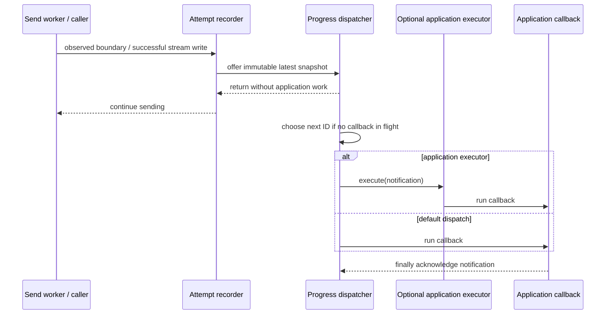
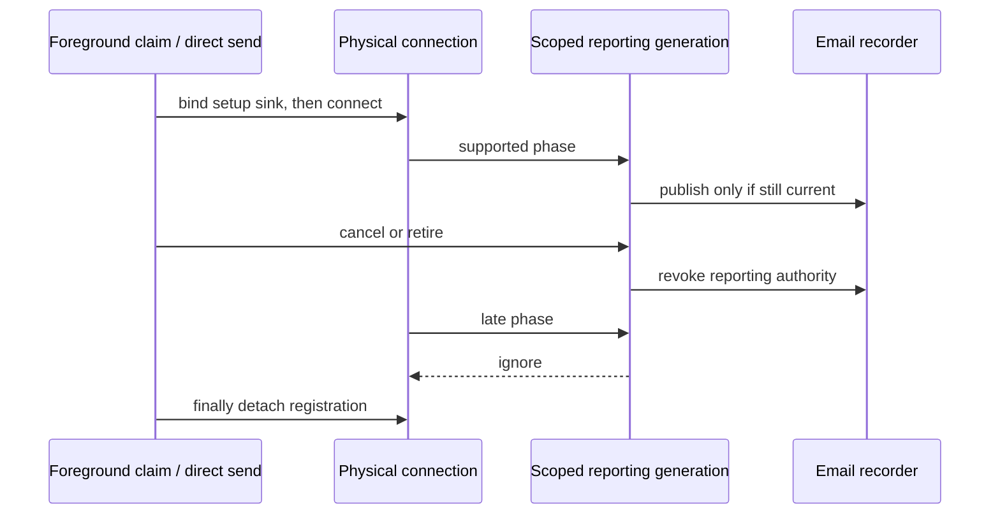

# Live send progress: a bounded reporting side channel

Progress tells a dashboard what is happening without giving that dashboard control over sending. Read [ADR 0032](../adr/0032-live-mail-send-progress.md)
for the public contract. The stage enum describes observations, not an engine state machine or a promise to deliver every transition.

## Ownership and state

| Owner | State | Lifetime |
| --- | --- | --- |
| Initiating Mailer's `MailSendObserverNotifier` | Separate result observer and optional progress dispatcher | Mailer |
| `MailSendAttempt` | Observation UUID, optional progress recorder and independent diagnostics | One reached logical email, including failover/retries |
| `MailSendProgressRecorder` | Latest stage/counters, sequence, monotonic origin, terminal fence | Same logical email |
| `MailSendProgressDispatcher` | Linked pending-ID map, one in-flight notification, daemon thread, closed flag | Lazily activated reporting; not a send resource |
| Managed Angus transport | Invocation-scoped progress sink and counting stream | Under its existing transport monitor; cleared in `finally` |
| `MailSendProgressScope` | One setup/submission generation and its permitted categories | Physical setup or provider invocation; revoked on cancellation/retirement |

The 1,024-ID limit bounds a lagging consumer's retained latest states; it does not bound sends. Upload-only snapshots are published at most every
250 ms so normal stream writes do not each allocate a report. Neither value is a throughput setting. Stage changes and final counts bypass throttling,
but pending snapshots can still replace them. A second send of the same Email has its own UUID and recorder.

Even a direct executor, or one whose `execute` blocks, runs from the dispatcher rather than SMTP/cancellation/retry threads. A silently discarded
executor task stalls reporting until shutdown because the dispatcher cannot honestly infer that it ran. Runtime rejection abandons that notification;
there is no inline fallback. An executor that starts a task and then throws must not release the in-flight slot while that callback is running.
The library never waits for progress. An application that deliberately shares its executor with sending can still starve that shared resource;
independent callback capacity is the application's responsibility when supplying an executor.

## Locks and fences

- The recorder monitor serializes sequence/counter updates and its once-only `FINISHED` publication. Late provider observations are ignored.
- The dispatcher monitor protects only pending/in-flight/closed bookkeeping. It is never held across application callbacks or `Executor.execute`.
- A recorder can enter the dispatcher monitor; dispatch never calls back into a recorder. A transport may call the recorder while holding its own
  monitor, but neither recorder nor dispatcher invokes application code on that thread. No reverse transport-lock edge is introduced.
- The in-flight notification owns its acknowledgement. Late/duplicate execution of a rejected or already delivered task cannot start another callback.
- Shutdown waits for send operations through the existing lifecycle, then closes reporting: stop accepting snapshots, clear pending entries and wake
  the dispatcher. An already executing callback is not interrupted or joined. A handed-off but unstarted notification becomes a no-op.

A queued notification is a static, detachable task, not an inner object implicitly retaining the dispatcher. Closing reporting or rejecting a handoff
clears its owner and snapshot; starting a callback transfers those references to the executing stack. An application executor may keep the inert Runnable
indefinitely without keeping the observer's captured application state alive. An actually running, blocked callback still owns its stack until it returns;
shutdown does not interrupt application code to reclaim it. Detachment and the started check share the dispatcher monitor, so closure cannot race a queued
task into a second callback, and an executor that starts then throws still occupies the callback slot until completion.

## Physical setup and provider-generation fencing

[ADR 0033](../adr/0033-detailed-mail-send-progress.md) extends reporting, not recovery control. Direct acquisition binds just before connecting.
Pooled acquisition forwards the upstream physical Transport and claim identity through `PoolConnectionObserver.connectionStarting(transport)`.
The parameterless callback still owns logical recovery evidence, including a healthy reused lease. Physical setup progress cannot settle that evidence.
Background allocations use their existing recovery observer without an email scope. Retained batch/open setup similarly has no individual-email recorder.

The recorder tracks the active scope by identity. Starting a new scope or moving orchestration to another phase detaches the old scope. Provider calls
check identity under the recorder monitor before publishing. Closing an old scope cannot restore a coarse stage over a newer phase. Setup scopes accept
only setup categories; submission scopes accept envelope/content observations. Neither can publish FINISHED or change submission attempt numbers.

Cancellation revokes reporting via the existing control registration without acquiring the transport monitor. The execution's finally block closes
the optional provider registration. Managed Angus detachment uses compare-and-set on the registered sink identity: an old cleanup cannot detach a newer
binding. No provider hook is called while holding the recorder monitor. SPI registration/cleanup RuntimeExceptions do not become connection failures.

## Terminal result is a separate boundary

`MailSendAttempt.complete` publishes `FINISHED` once, then follows the established result notification/completion contract. Result delivery and progress
delivery use different mechanisms. A callback already in flight can report PREPARING after the application has received the final result. Consumers
must keep terminal state by observation ID and ignore subsequent progress; FINISHED itself says nothing about success or acceptance.

Lazy batches create recorders only when reaching an email. Shared setup/teardown remains outside these recorders. Retry invocations reset bytes and
increment the attempt counter; connection failover does neither. Every logical send generates its UUID and invokes any configured handler factory
before preparation and admission. If the resulting choices enable no reporting, the send allocates no callback, counter stream or progress clock.

## Regression landmarks

- [Dispatcher tests](../../modules/simple-java-mail/src/test/java/org/simplejavamail/mailer/internal/MailSendProgressDispatcherTest.java): bounded retention,
  coalescing, serialization, rejection, callback failures, reentrancy, detached retained Runnables and shutdown while an application callback is blocked.
- [Recorder tests](../../modules/simple-java-mail/src/test/java/org/simplejavamail/mailer/internal/MailSendProgressRecorderTest.java): deterministic clock,
  throttling, retry resets, stale-update fence, mismatched totals and read-model serialization/privacy.
- [SMTP tests](../../modules/simple-java-mail/src/test/java/org/simplejavamail/mailer/internal/MailSendProgressSmtpTest.java): actual DATA/BDAT, final-reply barrier,
  logical ID correlation, retained scopes and result delivery ahead of delayed progress.
- [Boundary tests](../../modules/simple-java-mail/src/test/java/org/simplejavamail/mailer/internal/MailSendProgressBoundaryTest.java): selected-destination
  ownership, rate-wait cancellation, registration replacement, CustomMailer and unchanged attachment reads/protocol work.
- [Detailed protocol tests](../../modules/simple-java-mail/src/test/java/org/simplejavamail/mailer/internal/MailSendDetailedProgressTest.java): barriers at
  greeting, EHLO/HELO, STARTTLS, authentication and envelope commands; cancellation, reused/background connections and shared scopes.
- [Scope tests](../../modules/simple-java-mail/src/test/java/org/simplejavamail/mailer/internal/MailSendProgressScopeTest.java): retired generations,
  concurrent late callbacks, cancellation without provider unregistration, category restrictions and retry-counter isolation.
- [Optional SPI tests](../../modules/core-module/src/test/java/org/simplejavamail/internal/util/MailTransportLifecycleProgressTest.java): old adapters,
  independent setup support and safe registration/cleanup failures.

## Infographic review

The detailed-stage extension changes neither resource layers nor the dispatcher contract. The shared image does not need regeneration.

The shared [inside-a-send infographic](assets/inside-a-mail-send.png) still describes the send engine's resource layers. Progress is an optional reporting
side channel, not another execution layer or changed resource owner. Its final-outcome path remains accurate; this page documents the new dispatcher
without regenerating that image or implying progress callbacks share terminal-result ordering.
