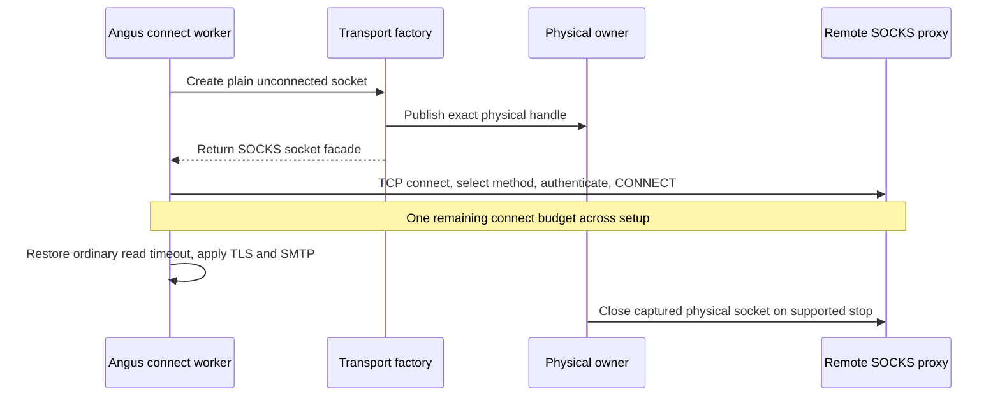

# Authenticated SOCKS socket ownership

Authenticated SOCKS uses the optional client module through Angus's independent transport-socket hook. The client logs in and opens the remote SMTP tunnel before Angus starts SMTP or TLS. There is no local listener, anonymous relay connection, setup executor or forwarding thread. [ADR 0042](../adr/0042-direct-authenticated-socks-sockets.md) owns this architecture; [ADR 0010](../adr/0010-authenticated-socks-bridge.md) preserves the former bridge design as history.

## Actors and ownership

| Actor | Responsibility |
| --- | --- |
| Angus transport factory decorator | Retain the selected application factory, create an unconnected plain socket and capture its physical handle before proxy setup. |
| `SocksSocket` | Wrap that physical socket, retain per-connection proxy credentials, authenticate and issue CONNECT using one cumulative connection budget. |
| Angus transport | Apply native read/write timeout handling, TLS and SMTP to the resulting destination socket. |
| Managed connection or probe tracker | Close its exact physical handle for supported abort and failed setup; a dedicated probe has fresh state. |
| Pool lease or retained scope | Keep the physical transport alive until release or disposal, using the existing registration and lease fences. |

Authenticated destinations keep foreground-only acquisition. Building a Mailer, inspecting choices or constructing a socket provider does not resolve names, connect, invoke application socket factories or start networking workers. Healthy pooled transports remain reusable. Removing the bridge does not enable background authenticated connection creation.

## Setup and closure

The socket facade's state monitor protects connection admission, destination publication and the closed flag. It never spans blocking network I/O or physical close. A racing close marks the facade closed before disposing its physical socket; a late successful handshake cannot publish a usable destination after closure. An original setup failure remains primary and cleanup failures are suppressed onto it.

The destination remains the original SMTP endpoint, including its address family or unresolved name. The physical connection goes to the configured proxy. Socket binding, options and passive endpoint inspection preserve that distinction. TLS stays with Angus, retaining the original SMTP hostname, SNI, client certificates and trust policy.

Zero connect timeout remains unlimited. A finite timeout is not restarted for authentication or CONNECT. Setup restores the ordinary read timeout before TLS and SMTP. No separate proxy read, idle or write timer is introduced.

## Failure isolation and supported abort

A complete RFC 1929 rejection carries typed authentication evidence from that connection. The invoking failover policy applies to fresh and cached facts; its authentication permission is disabled by default. A malformed reply remains an unknown failure, and certificate permission is independent. Concurrent sockets do not share credentials, probe state, failure facts or abort ownership.

For the supported managed route, stop closes the captured upstream socket without waiting for the SMTP monitor or a relay reader. Publication after stop still closes the late handle. The existing exclusive-lease fence prevents a retired callback from touching the next borrower. See [transport abort](07-angus-transport-abort.md#direct-authenticated-socks-in-the-development-lane) and [pool claims](06-pool-claims-and-leases.md).

Supplied Sessions and opaque factories retain their existing physical-abort and total-deadline limits. Authenticated connectivity alone grants neither capability. An unsupported provider is rejected before network effects; the connection cannot fall back to anonymous proxying. Local socket disposal, the remote peer's later EOF observation and SMTP acceptance remain different events.

## Source and regression anchors

- [SocksSocket](../../modules/authenticated-socks-module/src/main/java/org/simplejavamail/internal/authenticatedsockssupport/socks5client/SocksSocket.java): passive provider construction, setup budget, state monitor and physical ownership.
- [Socks socket controls](../../modules/authenticated-socks-module/src/test/java/org/simplejavamail/internal/authenticatedsockssupport/socks5client/SocksSocketProviderTest.java): endpoint/options, protocol boundaries and cleanup.
- [Direct routing](../../modules/simple-java-mail/src/test/java/org/simplejavamail/mailer/AuthenticatedSocksDirectRoutingTest.java), [pending setup](../../modules/simple-java-mail/src/test/java/org/simplejavamail/mailer/AuthenticatedSocksPendingSetupTest.java) and [established abort](../../modules/simple-java-mail/src/test/java/org/simplejavamail/mailer/AuthenticatedSocksEstablishedAbortTest.java): real provider-path ownership and cancellation boundaries.
- [Authentication failover](../../modules/simple-java-mail/src/test/java/org/simplejavamail/mailer/failover/SocksProxyAuthenticationFailoverTest.java): explicit permissions, cached failures and concurrent route isolation.
- [Unsupported provider](../../modules/simple-java-mail/src/test/java/org/simplejavamail/mailer/AuthenticatedSocksUnsupportedProviderTest.java): useful rejection before transport/factory/network effects or Session mutation.

These controls describe specific contracts and interleavings. They do not promise bounded completion for arbitrary native DNS, application callbacks or opaque custom socket code.
