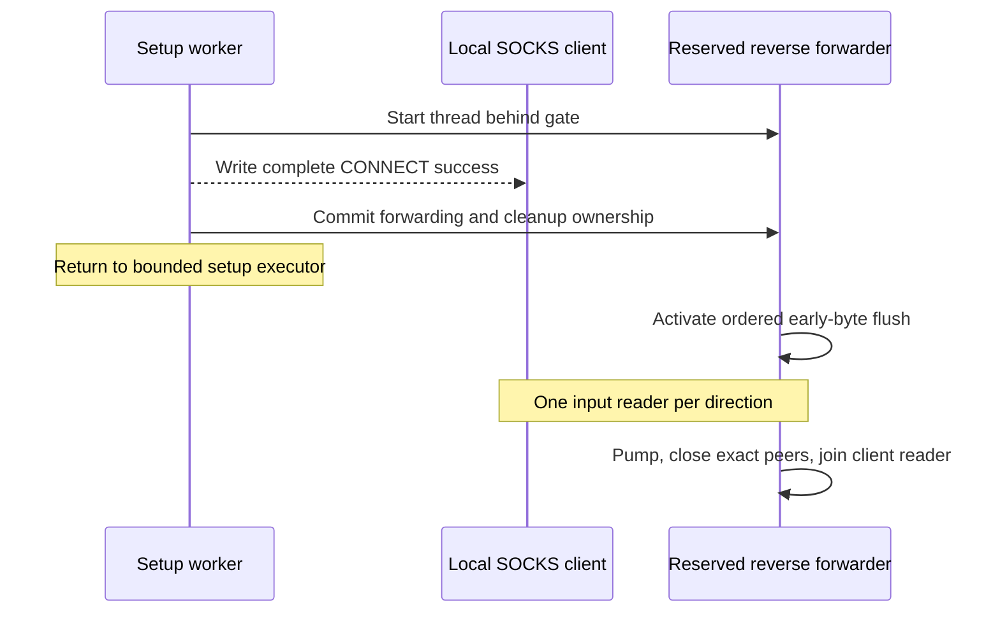

# Authenticated SOCKS setup and forwarding

The optional authenticated SOCKS module adapts the provider's anonymous local hop to a remote authenticated proxy. [ADR 0010](../adr/0010-authenticated-socks-bridge.md) owns its protocol and socket lifetimes; [ADR 0015](../adr/0015-execution-views-and-transport-pooling.md) keeps its setup capacity distinct from application workers and transport leases.

## Actors and ownership

| Actor | Responsibility |
| --- | --- |
| Listener generation | Bind IPv4 loopback, register each accepted owner, admit bounded setup work and retire only that generation. |
| Setup worker | Parse the local command, start its client reader, negotiate the owned remote socket and reserve forwarding before acknowledging success. Return after ownership transfers. |
| Original client reader | Observe pending peer EOF and buffer at most 8 KiB of early application bytes. Continue as the only local-input reader after handoff, preserving byte order. |
| Reserved reverse forwarder | Wait behind a gate until success and ownership transfer. Flush early bytes before later client writes, pump remote-to-local traffic, close the exact owner and join its client reader. |

The internal setup executor has zero core workers, at most 100 active workers, direct handoff without a waiting queue and a 30-second idle keep-alive. These are private resource choices, not public settings or an established-tunnel limit. A refused submission closes only its new registered peer; the listener continues and healthy tunnels remain usable. Setup workers may disappear while established connections remain open.

## Handoff order

`SocksTunnel` retains `PENDING`, `FORWARDING` and `CLOSED` under its lifecycle monitor. The complete local response precedes the atomic transfer to `FORWARDING`. A sticky transfer fact survives later closure, so a returning setup handler cannot reclaim forwarding cleanup. A failed thread start publishes no success; failed or late handoff closes that owner and releases its reserved thread.

Network operations and joins stay outside the lifecycle monitor. The output-order lock serializes the pending-byte flush with subsequent client writes. During committed activation, the client reader waits outside both locks until that flush is ready; direct closure releases the readiness and reservation gates without taking the output-order lock. The forwarding side owns the potentially blocking early-byte flush, so it cannot retain a setup worker.

The first non-null operational failure remains primary, including one reported after EOF retired the sockets. Close failures are suppressed, handles retain a single closer and fatal forwarding errors propagate after cleanup. [SocksSetupHandoffTest](../../modules/authenticated-socks-module/src/test/java/org/simplejavamail/internal/authenticatedsockssupport/socks5server/SocksSetupHandoffTest.java) covers worker release, publication order, thread-start failure, late client closure, ordered early data and fatal-error identity.

## Retirement and limits

Normal listener stop closes pending owners while established pooled or retained tunnels continue. Restart receives a separate owner registry. An unexpected listener failure closes its generation before interrupting its setup workers; old cleanup cannot retire a newer generation. [SocksSetupAdmissionTest](../../modules/authenticated-socks-module/src/test/java/org/simplejavamail/internal/authenticatedsockssupport/socks5server/SocksSetupAdmissionTest.java) covers actual bounded refusal, recovery, idle-worker retirement, established reuse and crash/restart isolation. [AuthenticatedSocksCapacityTest](../../modules/simple-java-mail/src/test/java/org/simplejavamail/mailer/AuthenticatedSocksCapacityTest.java) exercises another real Mailer connection while a hundred established scopes remain held, with independent remote-fixture headroom.

No independent bridge read, idle or write timer is introduced. The SMTP client remains the timeout authority. Established forwarding retains its blocking model: if the local reader is writing to the remote peer, or waiting behind the ordered early-byte flush, a later client EOF may wait until that operation returns. Direct owner closure does not acquire the ordering lock, but this capacity correction adds no cancellation correlation or extra EOF observer. [ADR 0017](../adr/0017-deadlines-and-physical-cancellation.md#alternatives-and-consequences) records that unchanged limitation.
