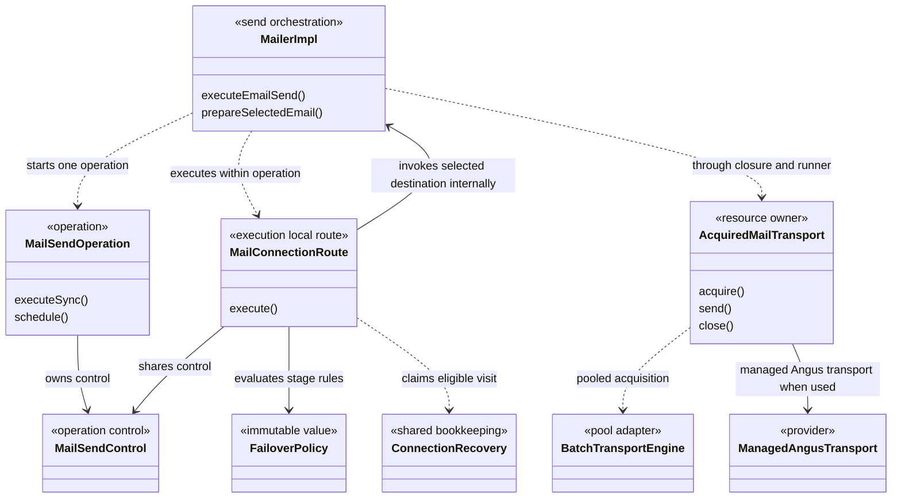
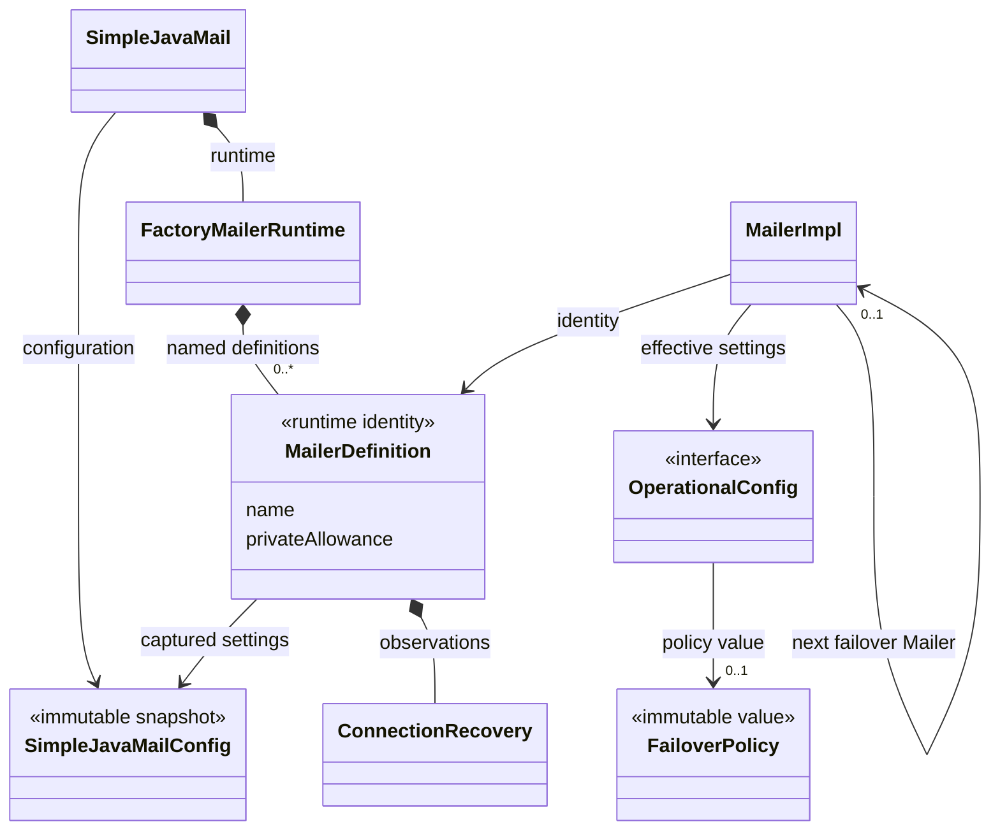
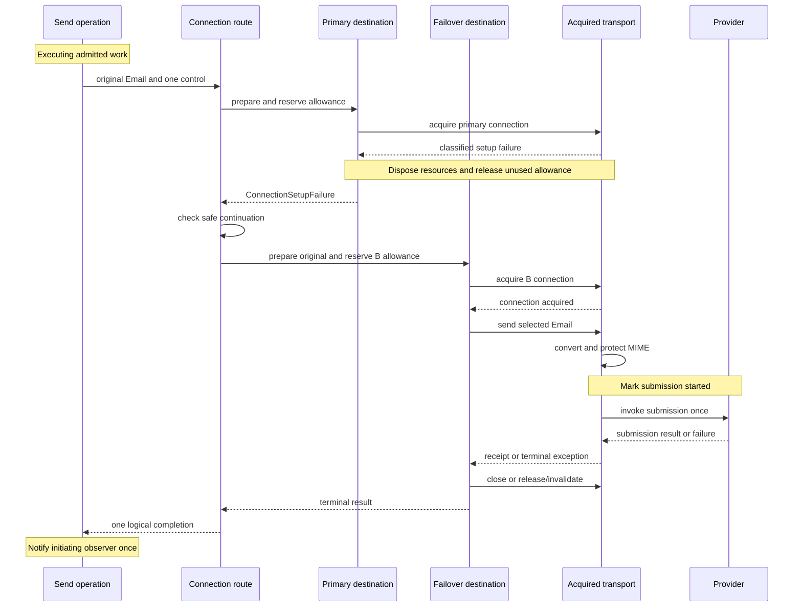
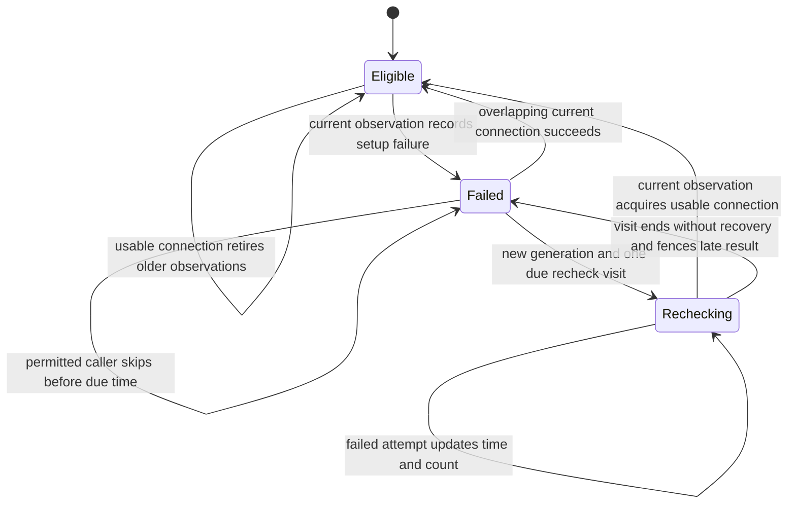
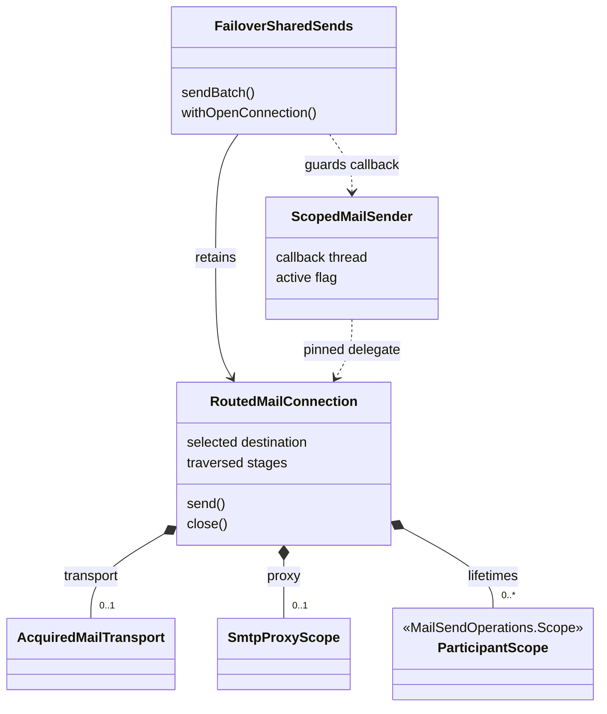

# SMTP connection failover architecture

[Failover documentation](README.md) · [Concurrency mechanism](../concurrency/10-connection-failover.md) · [Design decision](../adr/0029-smtp-submission-failover.md)

This guide describes the current connection-failover implementation: its responsibilities, abstractions, ownership, routing boundaries and maintenance contracts. Keep it aligned with code changes together with the concurrency mechanism and shared infographic.

Last aligned on **10 October 2026** with the unreleased 10.0.0 working-tree implementation on `codex/10.0.0`, based on HEAD `0fba80c1fb7581ed94a3b52f70534071132b42c8`. The implementation includes the optional modules and coordinated changes in the three local pool repositories.

## Architectural overview

Connection failover performs **destination routing before submission** inside the existing send operation. The initiating Mailer continues to supervise the work; a selected Mailer supplies the message rules and connection. This ownership split connects preparation, lifecycle, pooling and diagnostics to SMTP connection failure handling.

The responsibilities are split into four useful abstractions:

1. **Policy:** immutable rules describing permitted connection attempts and reconsideration intervals.
2. **Recovery:** factory-local observations about a configured destination, shared across operations.
3. **Routing:** an execution-local traversal of approved destinations, under one deadline and cancellation control.
4. **Resources:** explicit ownership of a usable transport, proxy use and participating Mailer lifetimes.

The router catches a dedicated connection-acquisition failure rather than catching every send failure. Once the provider or CustomMailer is invoked, that email cannot move to another destination, even if the provider fails before sending SMTP content.

The main maintenance costs are the larger orchestration role of `MailerImpl`, the indirect association between a pooled Session and its owning Mailer, and the additional retained-connection path for batches and application callbacks. Those are the places where future changes must preserve the ownership contracts described below.

## 1. Responsibilities in the onion

The [Inside a mail send infographic](../concurrency/assets/inside-a-mail-send.png) provides a useful responsibility map. Its rings describe execution layers, rather than a formal dependency-inverted onion architecture.

**Failover belongs principally around per-email sending and connection acquisition.** It chooses which destination enters the inner rings. The socket and SMTP adapter do not decide where an email goes next.

| Onion responsibility | Responsibility | Principal implementation |
| --- | --- | --- |
| **01 — Entry and supervision** | Admits the operation before destination-specific preparation, tracks use of delegated Mailers, and distinguishes borrowed from privately constructed failover Mailers. | `MailerImpl`, builders, `MailSendOperations` |
| **02 — Execution and control** | Runs selection, governance and validation inside the operation. All candidate visits share its cancellation and total deadline; delegated work stays on its executor. | `MailSendOperation`, `MailSendControl`, `MailSendAttempt` |
| **03 — Per-email send** | Traverses the route, prepares the original Email for each selected candidate, and separates connection acquisition from submission. | `MailConnectionRoute`, `ConnectionSetupFailure`, `AcquiredMailTransport`, `TransportRunner` |
| **04 — Connection pool** | Exposes finite candidate selection without borrowing, preserves setup evidence, and relays physical observations and background-replenishment permission. | `BatchModule`, `BatchSupport`, `BatchTransportEngine`, upstream pools |
| **05 — SMTP and network** | Preserves narrowly typed setup evidence for SMTP `421` and empty EOF while Angus is connecting; owns SMTP submission and receipt production. | `ManagedAngusTransport`, `SmtpServiceUnavailableException` |
| **Outcome reporting across the rings** | Records connection attempts and cached skips inside one terminal email outcome and accumulates preparation across candidates. | `MailSendAttempt`, `MailSendDiagnosticsRecorder`, `MailSendConnectionStep` |
| **Configuration outside the execution rings** | Captures named definitions and route policy, enforces locks, and supplies matching Spring/CLI inputs; runtime recovery stays outside configuration snapshots. | `FactoryMailerRuntime`, `ConfiguredFailover`, `ConfigLoader`, Spring/CLI adapters |

The following UML view shows the principal collaboration, omitting forwarding classes and individual fields. Solid arrows indicate an association or retained dependency; dashed arrows indicate use.

The infographic shows executor-side async preparation, routing/recovery in ring 03, and `AcquiredMailTransport` as the cleanup owner. Pool selection, provider setup evidence and connection history fit within these responsibilities; five rings remain sufficient. The [editable wording source](../concurrency/inside-a-mail-send.md) tracks artwork maintenance and the corresponding website asset.

## 2. Destination ownership and preparation

Preparing an Email before selecting its pooled destination could combine A's templates with B's connection. Selection therefore precedes destination-specific preparation, including when explicit failover is absent.

If A selects B, **B's ordinary defaults, overrides, validator, signing settings and connection configuration apply**. Every candidate starts from the original Email, so a failed A cannot leave its ordinary templates in the version prepared for B.

Mandatory message locks are a separate concern. The selected Mailer applies its own governance and locks; the traversed route stages contribute their mandatory message locks. For example, A's locked archive BCC survives routing to B, while A's ordinary default BCC does not. Preparation and validation are separated in `EmailSource` implementations so that validation can inspect the final governed and locked Email, including exact-EML envelope rules.

| Concern | Owner after routing |
| --- | --- |
| Executor, async admission, completion, total deadline, cancellation and public observer | Initiating Mailer |
| Ordinary Email templates, validation and destination-specific message security | Selected Mailer |
| Session, credentials, TLS requirements, proxy and provider behavior | Selected Mailer |
| Message and recipient allowance | Selected destination's allowance; explicitly shared groups remain shared |
| Mandatory message restrictions | Selected Mailer plus traversed route stages |
| Shared pool settings | Existing first-registration owner of the cluster |
| Recovery observations | Configured definition in its factory/runtime context |
| Physical transport or pooled lease | Acquired connection owner |

Consequently, async preparation failures complete the returned handle exceptionally during execution. Simple argument checks occur at entry, and admission may wait according to queue policy. A direct or caller-runs executor can execute preparation on the caller, but preparation belongs to operation execution rather than the pre-scheduling phase.

The original Email, attempt and control enter execution directly. `readyAt` means ready for admission, `startedAt` precedes preparation, and the preparation measurement accumulates work across visited candidates.

Source anchors: [MailerImpl](../../modules/simple-java-mail/src/main/java/org/simplejavamail/mailer/internal/MailerImpl.java), [EmailSource](../../modules/simple-java-mail/src/main/java/org/simplejavamail/email/internal/EmailSource.java), [MailSendAttempt](../../modules/simple-java-mail/src/main/java/org/simplejavamail/mailer/internal/MailSendAttempt.java).

## 3. Abstractions and their lifetimes

Routing, recovery and resource ownership live in `modules/simple-java-mail`. `core-module` supplies the public policy/diagnostic values and internal module bridges; `batch-module` and `angus-mail-provider-module` adapt acquisition and provider evidence. Spring and CLI consume the shared configuration rules. `MailerImpl` instances are composed through a relationship; there is no separate public failover Mailer type.

| Abstraction | Lifetime / boundary | Responsibility |
| --- | --- | --- |
| `FailoverPolicy` | Public immutable, serializable value in `core-module` | Setup-attempt count/delay, failed-destination recheck/backoff, independent authentication and certificate opt-ins. Holds no live Mailer or history. |
| `ConfiguredFailover` | Internal configuration helper | Resolve property/CLI inputs into the same policy and verify policy locks. |
| `FactoryMailerRuntime` and `Definition` | Factory lifetime | Give captured named definitions a stable identity; hold recovery and allowance identity beside immutable configuration. Independent builders receive independent definitions. |
| `ConnectionRecovery`, `Visit`, `Observation` | Definition lifetime; short-lived visit/observation handles | Cache failure facts, compute eligibility, coordinate one due recheck and fence stale results with observation generations and recheck ownership. |
| `DestinationConnectionObserver` | Destination instance, using shared definition state | Translate physical connection observations and background-allocation permission; deduplicate incident/recovery logs. |
| `MailConnectionRoute<T>` and `DestinationOperation<T>` | One route traversal | Walk stages and pinned cluster candidates; apply stage policy, bounded retries, cancellation and safe-continuation checks. The callback supports both email submission and retained connection opening. |
| `ConnectionSetupFailure` | Failed acquisition evidence | Classify reliable setup causes; check policy permission and unresolved cleanup. This exception is also the router's continuation boundary. |
| `PoolConnectionObserver`, `PoolConnectionSetupException` | Internal cross-module bridge in `core-module` | Let the optional batch module expose physical observations and setup evidence without depending on the main implementation. |
| `SmtpServiceUnavailableException` | Internal provider evidence | Represent setup-time SMTP `421` without teaching the router Angus-specific reply parsing. |
| `AcquiredMailTransport` | One acquired transport/lease | Own send access, abort registration, release/invalidation or physical close, and cleanup failure handling. Execution-confined. |
| `SmtpProxyScope` | Connection/proxy-use scope | Reference-count the selected destination's authenticated proxy use through ordinary and retained paths. |
| `RoutedMailConnection` | Retained batch/open-connection scope | Hold selected destination, traversed stages, transport, proxy and participant lifecycle scopes. |
| `FailoverSharedSends` | Batch or open-connection invocation | Adapt routing to a lazy iterator or a callback that runs once on a pinned connection. |
| `ScopedMailSender` | Application callback | Reject use from another thread or after the callback ends. Used by ordinary and failover open-connection paths. |
| `MailSendConnectionStep` | Public immutable diagnostic snapshot | Describe a destination acquisition or cached skip, distinct from submission/acceptance facts. |
| `CliFailoverMailerBuilder` | Internal generated-CLI facade | Expose named relationship and policy options without adding text-based overloads to the Java Mailer API. |

The public Java entry is the paired `withFailoverMailer(Mailer, FailoverPolicy)` / `clearFailoverMailer()` builder API, plus `OperationalConfig.getFailoverPolicy()`. A configured failover Mailer is an association between runtime objects, not a configuration value. Composition accepts SJM-created `MailerImpl` instances; a third-party Jakarta Mail provider can participate through one, but an arbitrary foreign implementation of `Mailer` cannot supply the required internal lifecycle contract.

The factory/configuration separation can be read as this UML ownership model. `MailerDefinition` represents the actual nested `FactoryMailerRuntime.Definition` class.

Repeated construction of a named definition within one factory shares its connection observations and private allowance identity, while the privately built Mailers and their resources remain separate instances. Equal hostnames do not imply shared identity. Supplied Mailers retain the identity of their own runtime context. Nothing here coordinates health or allowance across machines.

## 4. Routing and the submission boundary

An explicit relationship creates a **route stage**. A stage's policy applies to its candidate group; a following stage can override it with its own policy, or inherit it if none is configured. A selected cluster member contributes its destination configuration, rather than starting another independent public failover operation.

With failover enabled, the router captures a finite ordered candidate list on first entry to each cluster and visits each pinned registration once, apart from the policy's bounded setup retries. The upstream load-balancing strategy determines the order. After eligible group candidates are exhausted, routing follows the stage's explicit next Mailer. Without a policy, ordinary selection still chooses one destination; the preparation correction remains active.

Candidate selection reserves no connection capacity. After eligibility and participant admission, an individual send prepares/validates for that destination, resolves the envelope, reserves its allowance, starts the selected proxy and acquires a usable connection. MIME conversion and message protection then occur for the usable destination, immediately before submission. Failed connection candidates therefore do not require attachment serialization merely to route.

The diagram shows a successful fallback. If provider invocation, conversion or local preparation fails, it does not authorize another connection route for that email. `MailSendAttempt` retains the submission-started fact even without an observer, so replay prevention is not dependent on collecting diagnostics.

| Failure or wait | Routing decision |
| --- | --- |
| Classified DNS/refusal/unreachable, socket timeout/disconnect, or setup `421` | May retry the connection or continue according to policy. |
| Authentication rejection | Continue only with its independent opt-in. |
| Certificate/server identity verification failure | Continue only with its independent opt-in; destination TLS requirements remain in force. |
| Credential-provider failure, local preparation/validation/capability/lock error, or opaque setup cause | Stop. |
| Busy pool/claim-capacity timeout, queue pressure or rate-limit wait | Keep the ordinary waiting/failure contract; do not mark an outage. |
| Cancellation, interruption, shutdown or total deadline | Stop under the operation/lifecycle contract. |
| Setup failure with unresolved cleanup | Stop before starting another destination. |
| Provider/CustomMailer invocation or later submission/cleanup failure | Complete using existing failure/receipt semantics; do not replay. |

`ConnectionSetupFailure` inspects both causes and Jakarta Mail `nextException` chains, guards against cycles, and gives certificate/authentication evidence precedence over nested network symptoms. It extends `MailException`, preserving that public catch boundary even when no failover is configured or continuation is forbidden. The managed Angus hook is enabled only during `protocolConnect`, so a later SMTP `421` does not become setup evidence. Its empty-EOF handling depends on Angus 2.0.5's exact `[EOF]` sentinel.

Source anchors: [MailConnectionRoute](../../modules/simple-java-mail/src/main/java/org/simplejavamail/mailer/internal/MailConnectionRoute.java), [ConnectionSetupFailure](../../modules/simple-java-mail/src/main/java/org/simplejavamail/mailer/internal/ConnectionSetupFailure.java), [TransportRunner](../../modules/simple-java-mail/src/main/java/org/simplejavamail/mailer/internal/util/TransportRunner.java), [ManagedAngusTransport](../../modules/angus-mail-provider-module/src/main/java/org/simplejavamail/internal/mailprovider/angus/ManagedAngusTransport.java).

## 5. Recovery is shared bookkeeping, with operation-led probing

`ConnectionRecovery` stores failure evidence, failure time/count, an observation generation and an optional active recheck. It uses monotonic time. Each caller evaluates its own policy against those facts; a permissive caller's authentication or certificate setting does not authorize a stricter caller to bypass that destination.

These are explanatory states, not a new enum or public health API. A stricter caller stops on cached evidence when skipping is not permitted; once due, it can recheck the original destination. A working failover destination can serve other operations while one caller checks the failed primary. Successful acquisition restores eligibility and clears failure/backoff state without resetting sending-limit history.

The monitor protects bookkeeping only. Acquisition, waits, disposal, logging and callbacks execute outside it. `Observation` captures a generation and its current recheck `Visit`, and publishes at most once while both remain valid. A failure leaves that generation open: a concurrent connection can still succeed and restore preference. Success, or the start of a deliberate due recheck, advances the generation and retires older results. Closing/cancelling a visit fences unfinished results from that visit without invalidating a replacement. After successful recovery, an old visit still finishing its send no longer owns new observations or blocks the next incident's recheck. The [publication table](../concurrency/10-connection-failover.md#publication-rules) records these transition rules and their regressions.

These are separate state machines with separate owners: route traversal decides whether another destination may be visited, recovery decides which connection observations remain valid, and the acquired transport owns release/invalidation. A general rules engine would not remove those lifetime constraints. Keep the transitions explicit inside their owners and test the contracts across them, including the public failure type and retained-scope lease behavior. Do not introduce one global send state whose combinations also encode pool, cancellation and provider state.

There is no new health executor. Once coordinated failover applies, recorded failure blocks background creation until an operation obtains usable-connection evidence. Expiry of the recheck interval alone does not let pool maintenance probe the destination. Existing healthy leases remain usable, and a successful borrowed lease can also clear the failure observation. An allocation already underway is not synchronously revoked by the gate.

Source anchors: [ConnectionRecovery](../../modules/simple-java-mail/src/main/java/org/simplejavamail/mailer/internal/ConnectionRecovery.java), [DestinationConnectionObserver](../../modules/simple-java-mail/src/main/java/org/simplejavamail/mailer/internal/DestinationConnectionObserver.java).

## 6. Pool and provider integration boundaries

The dependency chain is SJM batch support → SMTP Connection Pool → Clustered Object Pool → Generic Object Pool. The integration APIs carry selection/evidence/permission, while the routing policy stays in SJM.

| Boundary | Integration contract | Architectural purpose |
| --- | --- | --- |
| SJM main → optional batch module | Candidate-list API, observer-aware registration, `PoolConnectionSetupException` | Keep pool implementations optional; expose enough information to route without guessing from arbitrary pool errors. |
| Batch engine → SMTP pool | `TransportConnectionObserver`, candidate selection and typed `SmtpConnectionException` | Observe physical setup and route callbacks by the actual registration's Session. The observer map is removed as pools shut down. |
| SMTP pool → clustered pool | Finite candidate traversal returning pinned selections | Respect configured load balancing while preventing repeated or replacement registration selection within the captured route. |
| Clustered pool → generic pool | `Allocator.isBackgroundAllocationAllowed()` | Defer automatic replenishment without making up an allocation error or occupying capacity for refused maintenance. Default remains permissive. |
| Angus → SJM evidence | Setup-only `421` / empty-EOF translation | Normalize provider-specific evidence before the routing classifier sees it. |

Selection handles (`SelectedPoolTransport`, `SmtpTransportSelection`, `ResourcePoolSelection`) represent the registrations in finite candidate lists rather than acquired resources. Retirement causes a subsequent claim to fail instead of silently substituting a new registration with the same key.

`PoolConnectionObserver` is an internal connection bridge, separate from the application's `MailSendObserver`. The batch engine has one upstream allocator observer and dispatches by Session to the correct destination state. Old registration overloads use `NONE` to preserve their default behavior.

The local implementation uses SMTP Connection Pool **4.4.0-SNAPSHOT**, Clustered Object Pool **4.3.0-SNAPSHOT**, and Generic Object Pool **2.6.0-SNAPSHOT**. Release integration must pin and verify published compatible versions; the SJM POM and coordinated upstream implementation remain the dependency sources of truth.

Source anchors: [BatchModule](../../modules/core-module/src/main/java/org/simplejavamail/internal/modules/BatchModule.java), [BatchTransportEngine](../../modules/batch-module/src/main/java/org/simplejavamail/internal/batchsupport/BatchTransportEngine.java), [batch-module POM](../../modules/batch-module/pom.xml).

## 7. Resource and retained-scope behavior

`TransportRunner` delegates transport ownership to `AcquiredMailTransport`. That owner holds either a direct transport with its abort registration or a pooled lease. Closing a successful pooled connection means **release for reuse**, while a send failure normally invalidates it; direct connections are physically closed. Cleanup preserves the primary exception and existing acceptance/receipt handling. Failed acquisition must finish disposal before the router starts a replacement.

Delegation also participates in Mailer lifecycle admission. `MailSendOperations` tracks a stack of executing owners, so a callback cannot synchronously wait for a participating Mailer to close its own operation. Privately built named failover Mailers are owned and closed by their initiating object; supplied Mailers are borrowed. Construction validates the graph and known lock conflicts before allocating private resources, with rollback for failed construction.

| Sending form | Retained-connection contract |
| --- | --- |
| Individual sync/async Email | Route before that email's submission; one operation and terminal outcome. |
| Simple batch with explicit failover | Preserve one lazy iterator. Finish the current email and observer handoff before reconsidering earlier stages. Acquire a recovered preferred connection before releasing the retained one; move only untouched emails. Stop on the first email failure. |
| `withOpenConnection` with explicit failover | Route initial acquisition, then pin the selected connection. Invoke the application callback once; recovery does not replay or move it. |
| Ordinary simple batch or open-connection callback | Owns a dedicated, non-pooled connection. The callback uses the same `ScopedMailSender` thread/scope guard. |

Shared connection setup is outside individual email diagnostics, so its opening/closing cost is not repeated as a fictitious per-email attempt. Connection wrappers are confined to the executing thread; concurrent cancellation aborts the underlying transport without invoking wrapper cleanup or releasing its lease. The callback sender becomes unusable in `finally`, before cleanup starts.

Failover-enabled scopes retain a selected pool lease when the batch module is present, or a direct connection otherwise. A lease occupies capacity through application work, inline observation and sending-limit waits; a healthy release need not close its socket. Do not synchronously wait inside that scope for another send that needs the same exhausted pool. The ordinary no-failover scopes keep their dedicated-connection behavior.

Remembering a send failure for lease invalidation does not mean that failure is still escaping the callback. If application code handles it, cleanup errors still fail the retained scope. If the callback instead throws, its exact exception remains primary and the scope attaches cleanup errors as suppressed exceptions.

Source anchors: [AcquiredMailTransport](../../modules/simple-java-mail/src/main/java/org/simplejavamail/mailer/internal/util/AcquiredMailTransport.java), [RoutedMailConnection](../../modules/simple-java-mail/src/main/java/org/simplejavamail/mailer/internal/RoutedMailConnection.java), [FailoverSharedSends](../../modules/simple-java-mail/src/main/java/org/simplejavamail/mailer/internal/FailoverSharedSends.java), [MailSendOperations](../../modules/simple-java-mail/src/main/java/org/simplejavamail/mailer/internal/MailSendOperations.java).

## 8. Configuration and observation surfaces

Named definitions under `simplejavamail.mailers.<name>.*` reuse the ordinary property vocabulary and parsers, but resolve independently: missing secondary settings are not inherited from the primary. `ConfiguredFailover` rejects orphan policy properties; graph validation rejects missing references/cycles and checks captured relationship identity and message-lock compatibility. Locks constrain the approved definition and nested route, rather than trusting a matching display name.

Spring adapts named/failover metadata and canonical/alias/provenance handling. The generated CLI exposes an internal text facade; `CliMailerProfile` includes named definitions, policies, locks and referenced security-file fingerprints so daemon reuse does not conflate materially different configurations. These are configuration adapters, not alternate failover engines.

Diagnostics attach `MailSendConnectionStep` history to the outcome: logical endpoint/name, attempted/acquired flags, optional duration and a bounded explanation. A cached skip is explicitly not a new acquisition. The recorder retains the first 63 entries plus the latest, with an omitted count; **64 is a diagnostic bound, not a routing bound**. Old constructors/serialized snapshots expose empty history, and unobserved sends do not allocate a history list. Factory incident logs remain available independently of per-email observation.

Source anchors: [ConfigLoader](../../modules/core-module/src/main/java/org/simplejavamail/config/ConfigLoader.java), [MailerGenericBuilderImpl](../../modules/simple-java-mail/src/main/java/org/simplejavamail/mailer/internal/MailerGenericBuilderImpl.java), [MailSendDiagnosticsRecorder](../../modules/simple-java-mail/src/main/java/org/simplejavamail/mailer/internal/MailSendDiagnosticsRecorder.java), [CliMailerProfile](../../modules/cli-module/src/main/java/org/simplejavamail/internal/clisupport/CliMailerProfile.java).

## 9. Maintenance contracts and tradeoffs

| Architectural property | Maintenance contract / tradeoff |
| --- | --- |
| **Policy, observations, operation and resources have distinct owners.** | Strong separation. Preserve it: configuration snapshots should remain free of recovery state; pools should remain free of application routing policy. |
| **The no-replay boundary is explicit and independent of observation.** | Strong safety boundary. Preserve the marker before provider invocation and the narrow setup exception contract when adding providers or refactoring conversion. |
| **`MailerImpl` coordinates graph, resources and route execution.** | Main coupling cost. Its named helper steps remain readable, but future growth should use the existing route/resource seams. Consider an internal selected-destination context only if repeated plumbing materially grows. |
| **Selected ownership travels through `Session.getProperties()`.** | Concrete implicit dependency: the selected pool handle exposes a Session, and `selectedOwner()` recovers a `SessionOwner` wrapper containing `MailerImpl`. One Session must have an unambiguous owner; caller mutation/reuse can break that association. Document and regression-test this invariant; revisit a typed registration context if multi-owner Session support is required. |
| **Failure classification is structurally tied to exception evidence.** | Appropriate conservative choice, with provider-version sensitivity. Keep classification inside acquisition and retain wire tests for `[EOF]`, `421`, security precedence and local credential failures. New provider support needs explicit evidence rather than broader exception catching. |
| **Ordinary and retained sending have different orchestration paths.** | Justified by lazy-batch recovery and callback pinning. Maintain parity for governance, security, allowance, cancellation and cleanup; changes to one path require checking the other. |
| **Some helper classes are public for cross-package/module access.** | These are internal integration seams (`api.internal` / `internal`), despite Java visibility. Avoid treating them as customer extension APIs; intentional public additions are principally policy, paired builder methods and diagnostic history. |
| **Pooling consumes local SNAPSHOT dependencies.** | Explicit release integration dependency. Publish compatible upstream versions and reconcile the SJM POM before release verification; passing local tests does not establish artifact availability. |

Routing uses the existing operation scheduler. Recovery remains factory-local bookkeeping, and provider adapters report evidence rather than coordinating routes. The main maintenance boundaries are destination ownership and resource lifetimes.

## 10. Regression evidence and maintenance verification

The diagrams simplify forwarding calls. When changing a responsibility, update this guide, the [concurrency mechanism](../concurrency/10-connection-failover.md) and the [infographic maintenance source](../concurrency/inside-a-mail-send.md) together. Preserve the ownership and continuation contracts with the relevant regressions below.

The **10 October 2026 architecture baseline** passed **67 tests across nine suites, with zero failures, errors or skips** (10 in `core-module`, 57 in `simple-java-mail`). The selected suites cover policy/diagnostics, preparation ownership, routing, recovery, callback scope and actual loopback SMTP setup. The run used JDK 21, two test forks, test-failure ignoring disabled, and a local enforcer override for unpublished snapshots. License formatting was skipped. Its local log is `target/failover-architecture-focused-tests.log`; this is dated evidence, not an assertion that the tests rerun whenever this document changes.

The baseline also rendered and visually inspected all five Mermaid UML diagrams and confirmed that production module contents were unchanged by the documentation work. After editing diagrams or moving documentation, check relative links and render the updated Markdown again.

| Contract | Existing regression evidence |
| --- | --- |
| Selected templates and executor-side preparation | `SelectedMailerPreparationTest` |
| No replay, strict failure classification, capacity waits, disposal, locks and delegated lifecycle | `ConnectionFailoverTest` |
| One due recheck, backoff, policy isolation and stale-result fencing | `ConnectionRecoveryTest` |
| Greeting EOF, setup `421` and required-STARTTLS stopping on real loopback sockets | `SmtpConnectionFailoverWireTest` |
| Bounded history, accumulated preparation and unobserved safety facts | Diagnostics/attempt tests |
| Callback thread confinement and scope expiry | `ScopedMailSenderTest` and failover open-connection regressions |
| Named configuration, Spring and CLI identity | Named/Spring/CLI test sources and the earlier verification record; not rerun in this focused selection |

The [implementation verification record](../research/755-connection-failover-verification.md) records broader reactor, Java 11, upstream, provider-neutral, Spring/CLI and SMTP conformance checks, including a host TLS-interception limitation. Consult its dates and scope when using those results as evidence.

Related design records: [ADR 0029](../adr/0029-smtp-submission-failover.md), [connection failover concurrency mechanism](../concurrency/10-connection-failover.md), [implementation plan](../plans/755-smtp-connection-failover.md).
