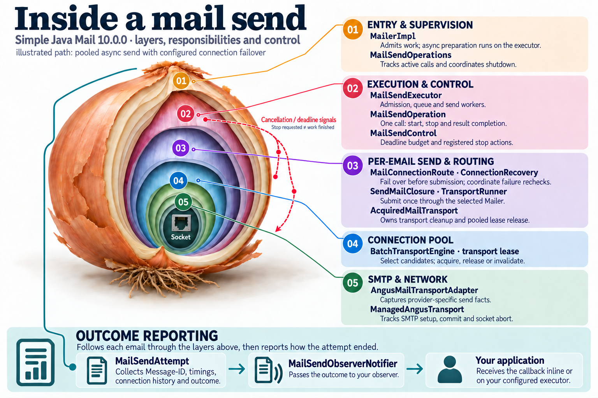
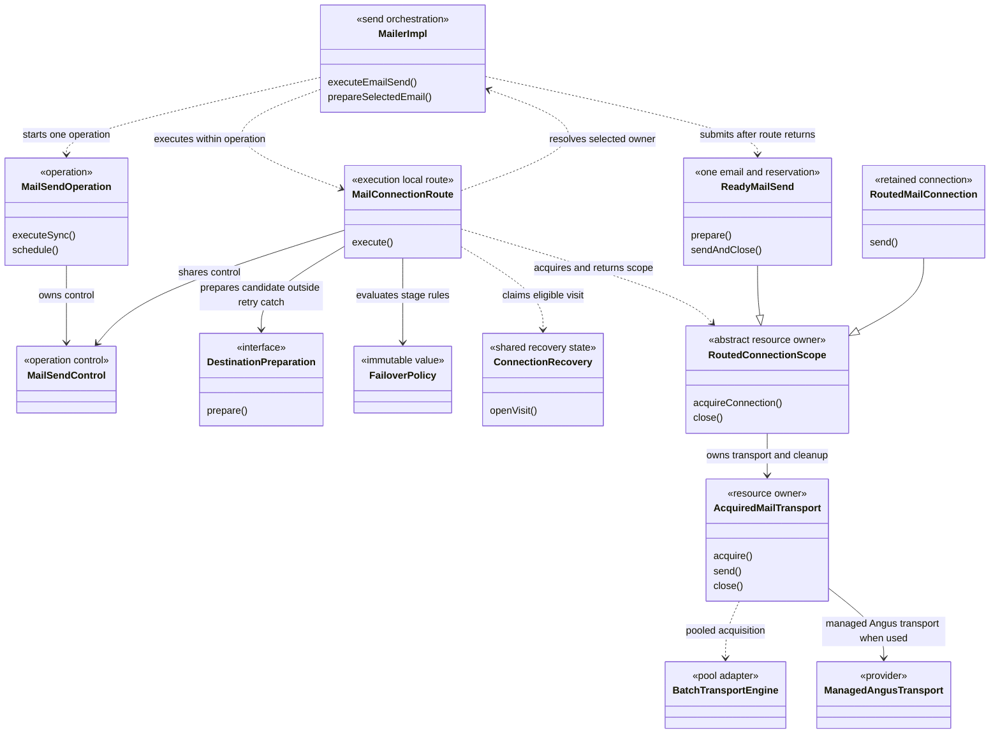
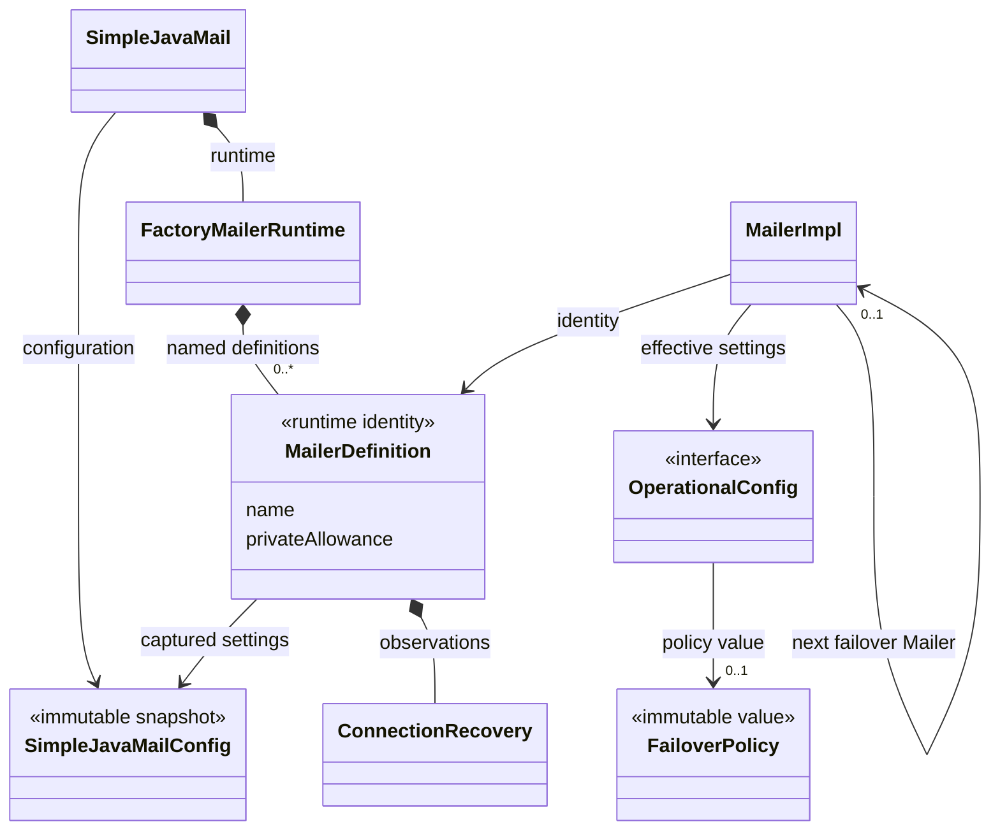
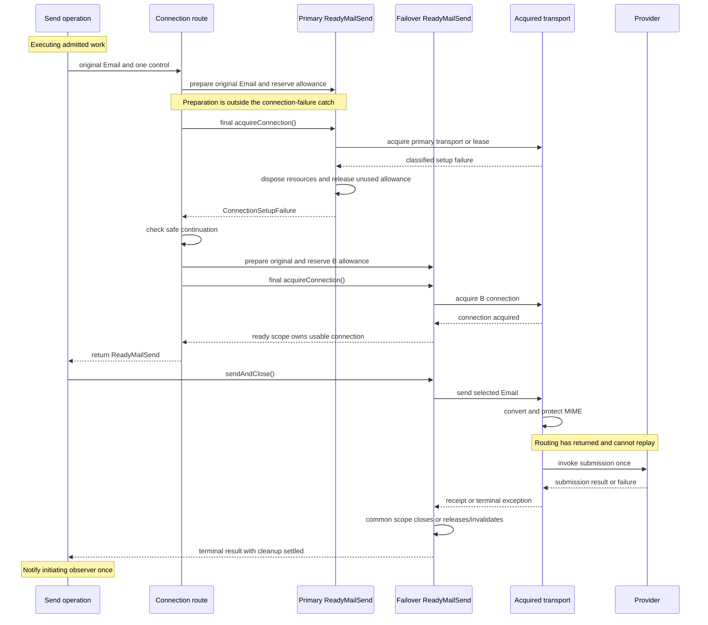
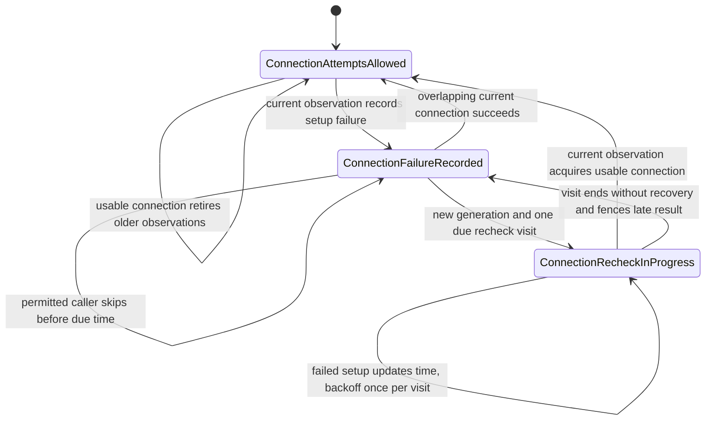
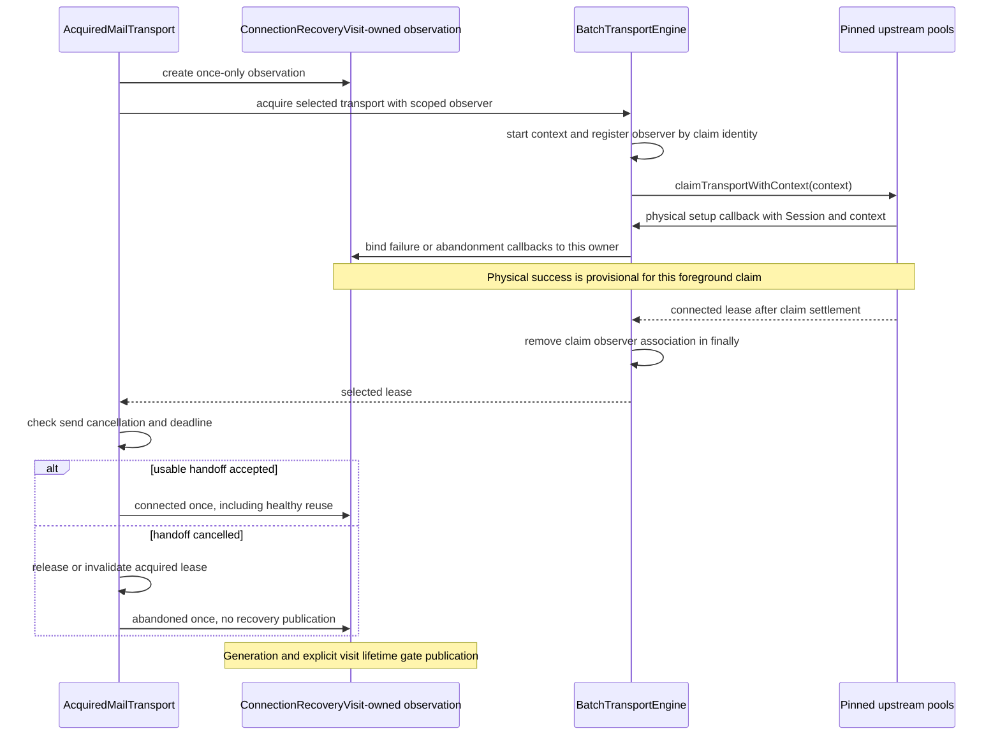
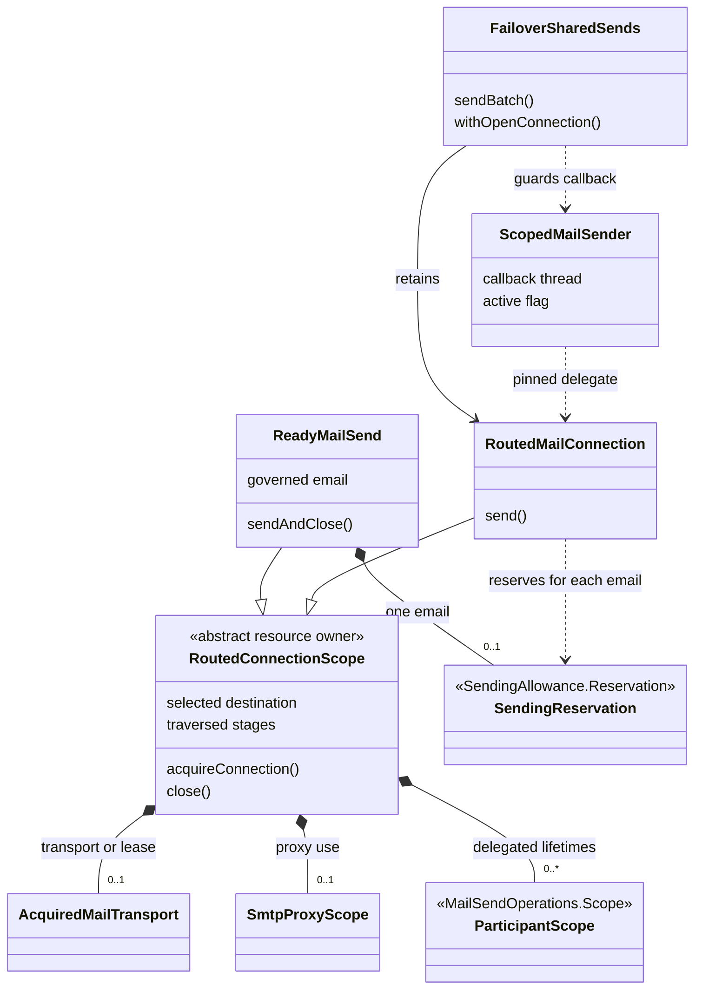

# SMTP connection failover architecture

[Failover documentation](README.md) · [Concurrency mechanism](../concurrency/10-connection-failover.md) · [Design decision](../adr/0029-smtp-submission-failover.md)

This guide describes the current connection-failover implementation: its responsibilities, abstractions, ownership, routing boundaries and maintenance contracts. Keep it aligned with code changes together with the concurrency mechanism and shared infographic.

Last aligned on **12 October 2026** with the unreleased 10.0.0 working-tree implementation on `codex/10.0.0`, including the explicit recovery-state and resource-scope refactor after local checkpoint `bb392ef0a5d1ff536dd12fd1584eb0d0889b8235`. The assessment includes the optional modules and current claim-context changes in the three local pool repositories. The [refactor verification record](../research/755-failover-state-refactor-verification.md) records runtime evidence separately from this source and diagram review.

## Architectural overview

Connection failover performs **destination routing before submission** inside the existing send operation. The initiating Mailer continues to supervise the work; a selected Mailer supplies the message rules and connection. This ownership split connects preparation, lifecycle, pooling and diagnostics to SMTP connection failure handling.

The responsibilities have five distinct owners:

1. **Policy:** immutable rules describing permitted connection attempts and reconsideration intervals.
2. **Recovery:** factory-local observations about a configured destination, shared across operations.
3. **Routing:** an execution-local traversal that returns an acquired destination scope, under one deadline and cancellation control.
4. **Resources:** a common scope owns transport, proxy use and participating Mailer lifetimes.
5. **Per-email work:** `ReadyMailSend` owns one governed Email and reservation; retained connections prepare and reserve for each Email separately. Submission runs after routing returns.

The router's continuation catch surrounds only the final connection-acquisition method. Preparation occurs before that catch; MIME conversion and provider or CustomMailer invocation occur after the route returns. The call structure enforces connection-only failover even when application or provider code throws a similarly typed exception. No mutable submission-started flag is needed.

The common resource scope reduces duplicated cleanup, and `ReadyMailSend` moves per-email reservation and submission work out of `MailerImpl`. The main integration costs are the indirect association between a pooled Session and its owning Mailer, observation identity across the pool layers, and the different per-email lifetimes of ordinary and retained sends. These are the principal [deeper review seams](#11-deeper-implementation-review-seams).

## 1. Responsibilities in the onion

The [Inside a mail send infographic](../concurrency/assets/inside-a-mail-send.png) provides a useful responsibility map. Its rings describe execution layers, rather than a formal dependency-inverted onion architecture.

**Failover belongs principally around per-email sending and connection acquisition.** It chooses which destination enters the inner rings. The socket and SMTP adapter do not decide where an email goes next.

| Onion responsibility | Responsibility | Principal implementation |
| --- | --- | --- |
| **01 — Entry and supervision** | Admits the operation before destination-specific preparation, tracks use of delegated Mailers, and distinguishes borrowed from privately constructed failover Mailers. | `MailerImpl`, builders, `MailSendOperations` |
| **02 — Execution and control** | Runs selection, governance and validation inside the operation. All candidate visits share its cancellation and total deadline; delegated work stays on its executor. | `MailSendOperation`, `MailSendControl`, `MailSendAttempt` |
| **03 — Per-email send** | Returns an acquired scope before submission; separates per-email preparation/reservation from common connection, proxy and participant ownership. | `MailConnectionRoute`, `ReadyMailSend`, `RoutedConnectionScope`, `RoutedMailConnection`, `AcquiredMailTransport` |
| **04 — Connection pool** | Exposes finite candidate selection without borrowing; carries claim identity and its observer through acquisition, preserving setup evidence and background-replenishment permission. | `SelectedPoolTransport`, `BatchSupport`, `BatchTransportEngine`, upstream `AllocationContext` |
| **05 — SMTP and network** | Preserves narrowly typed setup evidence for SMTP `421` and empty EOF while Angus is connecting; owns SMTP submission and receipt production. | `ManagedAngusTransport`, `SmtpServiceUnavailableException` |
| **Outcome reporting across the rings** | Records connection attempts and cached skips inside one terminal email outcome and accumulates preparation across candidates. | `MailSendAttempt`, `MailSendDiagnosticsRecorder`, `MailSendConnectionStep` |
| **Configuration outside the execution rings** | Captures named definitions and route policy, enforces locks, and supplies matching Spring/CLI inputs; runtime recovery stays outside configuration snapshots. | `FactoryMailerRuntime`, `ConfiguredFailover`, `ConfigLoader`, Spring/CLI adapters |

The following UML view shows the principal collaboration, omitting forwarding classes and individual fields. Solid arrows indicate an association or retained dependency; dashed arrows indicate use.

The infographic shows executor-side async preparation, routing/recovery in ring 03, and the physical transport/lease owner `AcquiredMailTransport`. `ReadyMailSend` and `RoutedConnectionScope` refine ownership within that ring; claim identity refines the pool integration in ring 04. The five responsibility rings remain accurate, and the infographic is a representative class map rather than an exhaustive list of helpers. The [editable wording source](../concurrency/inside-a-mail-send.md) records this maintenance checkpoint and the optimized website derivative.

## 2. Destination ownership and preparation

Preparing an Email before selecting its pooled destination could combine A's templates with B's connection. Selection therefore precedes destination-specific preparation, including when explicit failover is absent.

If A selects B, **B's ordinary defaults, overrides, validator, signing settings and connection configuration apply**. Every candidate starts from the original Email, so a failed A cannot leave its ordinary templates in the version prepared for B.

Mandatory message locks are a separate concern. The selected Mailer applies its own governance and locks; the traversed route stages contribute their mandatory message locks. For example, A's locked archive BCC survives routing to B, while A's ordinary default BCC does not. Preparation and validation are separated in `EmailSource` implementations so that validation can inspect the final governed and locked Email, including exact-EML envelope rules.

| Concern | Owner after routing |
| --- | --- |
| Executor, async admission, completion, total deadline, cancellation and public observer | Initiating Mailer |
| Ordinary Email templates, validation and destination-specific message security | Selected Mailer |
| Session, credentials, TLS requirements, proxy and provider behavior | Selected Mailer |
| Message and recipient allowance | Selected destination's allowance; explicitly shared groups remain shared |
| Mandatory message restrictions | Selected Mailer plus traversed route stages |
| Shared pool settings | Existing first-registration owner of the cluster |
| Recovery observations | Configured definition in its factory/runtime context |
| Governed Email and ordinary-send reservation | `ReadyMailSend`; retained sends prepare and reserve per Email |
| Proxy use and participating Mailer lifetimes | `RoutedConnectionScope` |
| Physical transport or pooled lease | `AcquiredMailTransport` |

Consequently, async preparation failures complete the returned handle exceptionally during execution. Simple argument checks occur at entry, and admission may wait according to queue policy. A direct or caller-runs executor can execute preparation on the caller, but preparation belongs to operation execution rather than the pre-scheduling phase.

The original Email, attempt and control enter execution directly. `readyAt` means ready for admission, `startedAt` precedes preparation, and the preparation measurement accumulates work across visited candidates.

Source anchors: [MailerImpl](../../modules/simple-java-mail/src/main/java/org/simplejavamail/mailer/internal/MailerImpl.java), [EmailSource](../../modules/simple-java-mail/src/main/java/org/simplejavamail/email/internal/EmailSource.java), [MailSendAttempt](../../modules/simple-java-mail/src/main/java/org/simplejavamail/mailer/internal/MailSendAttempt.java).

## 3. Abstractions and their lifetimes

Routing, recovery and resource ownership live in `modules/simple-java-mail`. `core-module` supplies the public policy/diagnostic values and internal module bridges; `batch-module` and `angus-mail-provider-module` adapt acquisition and provider evidence. Spring and CLI consume the shared configuration rules. `MailerImpl` instances are composed through a relationship; there is no separate public failover Mailer type.

| Abstraction | Lifetime / boundary | Responsibility |
| --- | --- | --- |
| `FailoverPolicy` | Public immutable, serializable value in `core-module` | Setup-attempt count/delay, failed-destination recheck/backoff, independent authentication and certificate opt-ins. Holds no live Mailer or history. |
| `ConfiguredFailover` | Internal configuration helper | Resolve property/CLI inputs into the same policy and verify policy locks. |
| `FactoryMailerRuntime` and `Definition` | Factory lifetime | Give captured named definitions a stable identity; hold recovery and allowance identity beside immutable configuration. Independent builders receive independent definitions. |
| `ConnectionRecovery`, `ConnectionRecoveryState`, `ConnectionFailureIncident`, `ConnectionRecoveryVisit`, `ConnectionRecoveryObservation` | Definition lifetime; short-lived visit/observation handles | `ConnectionAttemptsAllowed`, `ConnectionFailureRecorded` and `ConnectionRecheckInProgress` own transitions. Generation fences older connection windows; explicit visit ownership fences cancellation. Failure leaves overlapping success eligible to publish; backoff advances once per failed recheck visit. |
| `DestinationConnectionObserver` | Destination instance, using shared definition state | Translate physical connection observations and background-allocation permission; deduplicate incident/recovery logs. |
| `MailConnectionRoute<T>` and `DestinationPreparation<T>` | One route traversal | Walk stages and pinned cluster candidates; apply stage policy, bounded retries, cancellation and safe-continuation checks. Preparation produces an owned candidate, never a receipt or submission callback. Only final connection acquisition is caught for failover. |
| `ConnectionSetupFailure` | Failed acquisition evidence | Classify reliable setup causes; check policy permission and unresolved cleanup. This exception is also the router's continuation boundary. |
| `PoolConnectionObserver`, `PoolConnectionSetupException` | Internal cross-module bridge in `core-module` | Let the optional batch module expose physical observations and setup evidence without depending on the main implementation. |
| `AllocationContext` claim identity and batch observer association | One started upstream claim, through settlement | Preserve one opaque identity and remaining budget through narrowed contexts; bind foreground setup to its explicit observer and remove the association in `finally`. Background work retains an independent lifetime. |
| `SmtpServiceUnavailableException` | Internal provider evidence | Represent setup-time SMTP `421` without teaching the router Angus-specific reply parsing. |
| `AcquiredMailTransport` | One acquired transport/lease | Own send access, abort registration, release/invalidation or physical close, and cleanup failure handling. Execution-confined. |
| `SmtpProxyScope` | Connection/proxy-use scope | Reference-count the selected destination's authenticated proxy use through ordinary and retained paths. |
| `RoutedConnectionScope` | Execution-confined resource scope | Final acquisition boundary and common cleanup for transport, proxy and delegated lifetimes; cannot submit. |
| `ReadyMailSend` | One ordinary send | Governs from the original Email and reserves allowance before acquisition; submits only after routing returns. |
| `RoutedMailConnection` | Retained batch/open-connection scope | Uses the common resource scope, with separate per-email governance and allowance. |
| `FailoverSharedSends` | Batch or open-connection invocation | Adapt routing to a lazy iterator or a callback that runs once on a pinned connection. |
| `ScopedMailSender` | Application callback | Reject use from another thread or after the callback ends. Used by ordinary and failover open-connection paths. |
| `MailSendConnectionStep` | Public immutable diagnostic snapshot | Describe a destination acquisition or cached skip, distinct from submission/acceptance facts. |
| `CliFailoverMailerBuilder` | Internal generated-CLI facade | Expose named relationship and policy options without adding text-based overloads to the Java Mailer API. |

The public Java entry is the paired `withFailoverMailer(Mailer, FailoverPolicy)` / `clearFailoverMailer()` builder API, plus `OperationalConfig.getFailoverPolicy()`. A configured failover Mailer is an association between runtime objects, not a configuration value. Composition accepts SJM-created `MailerImpl` instances; a third-party Jakarta Mail provider can participate through one, but an arbitrary foreign implementation of `Mailer` cannot supply the required internal lifecycle contract.

The factory/configuration separation can be read as this UML ownership model. `MailerDefinition` represents the actual nested `FactoryMailerRuntime.Definition` class.

Repeated construction of a named definition within one factory shares its connection observations and private allowance identity, while the privately built Mailers and their resources remain separate instances. Equal hostnames do not imply shared identity. Supplied Mailers retain the identity of their own runtime context. Nothing here coordinates health or allowance across machines.

## 4. Routing and the submission boundary

An explicit relationship creates a **route stage**. A stage's policy applies to its candidate group; a following stage can override it with its own policy, or inherit it if none is configured. A selected cluster member contributes its destination configuration, rather than starting another independent public failover operation.

With failover enabled, the router captures a finite ordered candidate list on first entry to each cluster and visits each pinned registration once, apart from the policy's bounded setup retries. The upstream load-balancing strategy determines the order. After eligible group candidates are exhausted, routing follows the stage's explicit next Mailer. Without a policy, ordinary selection still chooses one destination; the preparation correction remains active.

Candidate selection reserves no connection capacity. After eligibility and participant admission, an individual send prepares/validates for that destination, resolves the envelope, reserves its allowance, starts the selected proxy and acquires a usable connection. MIME conversion and message protection then occur for the usable destination, immediately before submission. Failed connection candidates therefore do not require attachment serialization merely to route.

The diagram shows a successful fallback. If provider invocation, conversion or local preparation fails, it does not authorize another connection route for that email. `MailConnectionRoute` returns a `ReadyMailSend` before any MIME conversion or provider invocation. Its connection-failure catch surrounds only the final `RoutedConnectionScope.acquireConnection` method, which cannot submit. Governance and allowance preparation are outside that catch too. Replay prevention therefore no longer relies on a mutable flag or diagnostic collection.

| Failure or wait | Routing decision |
| --- | --- |
| Classified DNS/refusal/unreachable, socket timeout/disconnect, or setup `421` | May retry the connection or continue according to policy. |
| Authentication rejection | Continue only with its independent opt-in. |
| Certificate/server identity verification failure | Continue only with its independent opt-in; destination TLS requirements remain in force. |
| Credential-provider failure, local preparation/validation/capability/lock error, or opaque setup cause | Stop. |
| Busy pool/claim-capacity timeout, queue pressure or rate-limit wait | Keep the ordinary waiting/failure contract; do not mark an outage. |
| Cancellation, interruption, shutdown or total deadline | Stop under the operation/lifecycle contract. |
| Setup failure with unresolved cleanup | Stop before starting another destination. |
| Provider/CustomMailer invocation or later submission/cleanup failure | Stop routing to other destinations. Separately configured safe retries remain governed by [ADR 0030](../adr/0030-safe-bounded-mail-send-retries.md); preserve final failure/receipt semantics. |

`ConnectionSetupFailure` inspects both causes and Jakarta Mail `nextException` chains, guards against cycles, and gives certificate/authentication evidence precedence over nested network symptoms. It extends `MailException`, preserving that public catch boundary even when no failover is configured or continuation is forbidden. The managed Angus hook is enabled only during `protocolConnect`, so a later SMTP `421` does not become setup evidence. Its empty-EOF handling depends on Angus 2.0.5's exact `[EOF]` sentinel.

After failed acquisition cleanup, `MailConnectionRoute.checkStoppedAfterConnectionFailure` preserves the caught setup failure when cancellation or timeout prevents continuation. The stop exception retains suppressed cleanup errors too; it does not invent a receipt or start another destination. Remediable setup failures do not call terminal `translateFailure`, because that would freeze the stop classification for later work on a healthy destination.

Source anchors: [MailConnectionRoute](../../modules/simple-java-mail/src/main/java/org/simplejavamail/mailer/internal/MailConnectionRoute.java), [ReadyMailSend](../../modules/simple-java-mail/src/main/java/org/simplejavamail/mailer/internal/ReadyMailSend.java), [RoutedConnectionScope](../../modules/simple-java-mail/src/main/java/org/simplejavamail/mailer/internal/RoutedConnectionScope.java), [ConnectionSetupFailure](../../modules/simple-java-mail/src/main/java/org/simplejavamail/mailer/internal/ConnectionSetupFailure.java), [TransportRunner](../../modules/simple-java-mail/src/main/java/org/simplejavamail/mailer/internal/util/TransportRunner.java), [ManagedAngusTransport](../../modules/angus-mail-provider-module/src/main/java/org/simplejavamail/internal/mailprovider/angus/ManagedAngusTransport.java).

## 5. Recovery is shared bookkeeping, with operation-led probing

`ConnectionRecovery` uses private `ConnectionAttemptsAllowed`, `ConnectionFailureRecorded` and `ConnectionRecheckInProgress` state objects. The latter two own incident evidence/time/backoff; only `ConnectionRecheckInProgress` owns a due visit. It uses monotonic time. Each caller evaluates its own policy against those facts; a permissive caller's authentication or certificate setting does not authorize a stricter caller to bypass that destination.

`ConnectionAttemptsAllowed` permits setup attempts; it does not claim that the destination is healthy or already connected. These states manage transitions in code, without a public health API or general rules engine. A stricter caller stops on cached evidence when skipping is not permitted; once due, it can recheck the original destination. A working failover destination can serve other operations while one caller checks the failed primary. Successful acquisition restores eligibility and clears failure/backoff state without resetting sending-limit history.

The monitor protects bookkeeping only. Acquisition, waits, disposal, logging and callbacks execute outside it. `ConnectionRecoveryObservation` captures the current generation and an explicitly supplied `ConnectionRecoveryVisit` owner, or an independent/background lifetime. It never inherits an ambient active recheck. It publishes at most once while that generation and owner remain valid. A failure leaves that generation open: a concurrent connection can still succeed and restore preference. Success, or the start of a deliberate due recheck, advances the generation and retires older results. Closing/cancelling a visit fences unfinished results from that visit without invalidating a replacement. The visit ends after acquisition settles; the returned sending scope retains resources, not recheck ownership. A send still running therefore cannot block the next incident's recheck. The [publication table](../concurrency/10-connection-failover.md#publication-rules) records these transition rules and their regressions.

These are separate state machines with separate owners: route traversal decides whether another destination may be visited, recovery decides which connection observations remain valid, and the acquired transport owns release/invalidation. A general rules engine would not remove those lifetime constraints. Keep the transitions explicit inside their owners and test the contracts across them, including the public failure type and retained-scope lease behavior. Do not introduce one global send state whose combinations also encode pool, cancellation and provider state.

There is no new health executor. Once coordinated failover applies, recorded failure blocks background creation until an operation obtains usable-connection evidence. Expiry of the recheck interval alone does not let pool maintenance probe the destination. Existing healthy leases remain usable, and a successful borrowed lease can also clear the failure observation. An allocation already underway is not synchronously revoked by the gate.

Background setup also needs independent resource ownership. Authenticated SOCKS uses an operation-owned local bridge; the destination's immutable gate therefore disables background allocation, even while a foreground operation has the bridge running. A transient `isRunning()` check would race that operation's teardown. Foreground acquisition starts the bridge normally and can reuse healthy leases. Anonymous proxies/direct SMTP retain normal background behavior subject to recovery eligibility; logging-only and CustomMailer start no background SMTP work. The gate defers without reserving capacity or publishing a false server incident. This restriction is independent of whether failover is configured.

Source anchors: [ConnectionRecovery](../../modules/simple-java-mail/src/main/java/org/simplejavamail/mailer/internal/ConnectionRecovery.java), [DestinationConnectionObserver](../../modules/simple-java-mail/src/main/java/org/simplejavamail/mailer/internal/DestinationConnectionObserver.java).

## 6. Pool and provider integration boundaries

The dependency chain is SJM batch support → SMTP Connection Pool → Clustered Object Pool → Generic Object Pool. The integration APIs carry selection/evidence/permission, while the routing policy stays in SJM.

| Boundary | Integration contract | Architectural purpose |
| --- | --- | --- |
| SJM main → optional batch module | `SelectedPoolTransport.acquireTransport(control, observer)`, candidate-list API and `PoolConnectionSetupException` | Carry an explicit observation owner into the pinned acquisition while keeping pool implementations optional and capacity failures separate. |
| Batch engine → SMTP pool | Context-aware `TransportConnectionObserver`, `claimTransportWithContext` and typed `SmtpConnectionException` | Dispatch foreground setup by claim identity; use the Session observer for independent/background work. Remove claim associations after settlement and Session associations as pools shut down. |
| SMTP pool → clustered pool | Pinned selections and `claimWithContext` | Continue the same claim identity and budget without repeating load balancing or replacing a retired registration. |
| Clustered pool → generic pool | `AllocationContext.getClaimIdentity()`, budget narrowing and `Allocator.isBackgroundAllocationAllowed()` | Preserve caller attribution and the remaining deadline; defer refused background replenishment before reserving capacity. Default permission remains permissive. |
| Angus → SJM evidence | Setup-only `421` / empty-EOF translation | Normalize provider-specific evidence before the routing classifier sees it. |

Selection handles (`SelectedPoolTransport`, `SmtpTransportSelection`, `ResourcePoolSelection`) represent the registrations in finite candidate lists rather than acquired resources. Retirement causes a subsequent claim to fail instead of silently substituting a new registration with the same key.

`PoolConnectionObserver` is an internal connection bridge, separate from the application's `MailSendResultObserver` and `MailSendProgressObserver`. The batch engine has one upstream allocator observer. Foreground routed claims dispatch by `AllocationContext.getClaimIdentity()` to their explicitly registered observer; the association is removed in `finally` after claim settlement. Background and unrelated connections use the independent Session observer. Narrowed budgets preserve identity, and pinned `claimWithContext`/`claimTransportWithContext` methods do not reselect or restart the budget. Physical success is deferred until the caller accepts a usable lease after cancellation checks; abandonment is neither outage nor recovery. Old registration overloads use `NONE` to preserve their default behavior.

This UML sequence follows a successful foreground claim through the handoff boundary. Physical failures publish through the same explicitly bound observation during allocation; healthy lease reuse needs no new physical setup callback.

The implementation uses published [SMTP Connection Pool 4.4.0](https://github.com/simple-java-mail/smtp-connection-pool/releases/tag/4.4.0), [Clustered Object Pool 4.3.0](https://github.com/bbottema/clustered-object-pool/releases/tag/4.3.0) and [Generic Object Pool 2.6.0](https://github.com/bbottema/generic-object-pool/releases/tag/2.6.0). The supporting-library cascade was published on 12 October 2026. The SJM POM remains the dependency source of truth; publishing these dependencies does not publish or complete the SJM feature.

Source anchors: [BatchModule](../../modules/core-module/src/main/java/org/simplejavamail/internal/modules/BatchModule.java), [BatchTransportEngine](../../modules/batch-module/src/main/java/org/simplejavamail/internal/batchsupport/BatchTransportEngine.java), [batch-module POM](../../modules/batch-module/pom.xml).

## 7. Resource and retained-scope behavior

`RoutedConnectionScope` owns transport, proxy and participating lifetimes. `ReadyMailSend` additionally owns the governed email and its allowance reservation; `RoutedMailConnection` instead prepares and reserves separately for each retained-scope email. `AcquiredMailTransport` owns the physical transport or lease. That owner holds either a direct transport with its abort registration or a pooled lease. Closing a successful pooled connection means **release for reuse**, while a send failure normally invalidates it; direct connections are physically closed. Cleanup preserves the primary exception and existing acceptance/receipt handling. Failed acquisition must finish disposal before the router starts a replacement.

Delegation also participates in Mailer lifecycle admission. `MailSendOperations` tracks a stack of executing owners, so a callback cannot synchronously wait for a participating Mailer to close its own operation. Privately built named failover Mailers are owned and closed by their initiating object; supplied Mailers are borrowed. Construction validates the graph and known lock conflicts before allocating private resources, with rollback for failed construction.

| Sending form | Retained-connection contract |
| --- | --- |
| Individual sync/async Email | Route before that email's submission; one operation and terminal outcome. |
| Simple batch with explicit failover | Preserve one lazy iterator. Finish the current email and observer handoff before reconsidering earlier stages. Acquire a recovered preferred connection before releasing the retained one; move only untouched emails. Stop on the first email failure. |
| `withOpenConnection` with explicit failover | Route initial acquisition, then pin the selected connection. Invoke the application callback once; recovery does not replay or move it. |
| Ordinary simple batch or open-connection callback | Owns a dedicated, non-pooled connection. The callback uses the same `ScopedMailSender` thread/scope guard. |

Shared connection setup is outside individual email diagnostics, so its opening/closing cost is not repeated as a fictitious per-email attempt. Connection wrappers are confined to the executing thread; concurrent cancellation aborts the underlying transport without invoking wrapper cleanup or releasing its lease. The callback sender becomes unusable in `finally`, before cleanup starts.

Failover-enabled scopes retain a selected pool lease when the batch module is present, or a direct connection otherwise. A lease occupies capacity through application work, inline observation and sending-limit waits; a healthy release need not close its socket. Do not synchronously wait inside that scope for another send that needs the same exhausted pool. The ordinary no-failover scopes keep their dedicated-connection behavior.

Remembering a send failure for lease invalidation does not mean that failure is still escaping the callback. If application code handles it, cleanup errors still fail the retained scope. If the callback instead throws, its exact exception remains primary and the scope attaches cleanup errors as suppressed exceptions.

Source anchors: [RoutedConnectionScope](../../modules/simple-java-mail/src/main/java/org/simplejavamail/mailer/internal/RoutedConnectionScope.java), [ReadyMailSend](../../modules/simple-java-mail/src/main/java/org/simplejavamail/mailer/internal/ReadyMailSend.java), [AcquiredMailTransport](../../modules/simple-java-mail/src/main/java/org/simplejavamail/mailer/internal/util/AcquiredMailTransport.java), [RoutedMailConnection](../../modules/simple-java-mail/src/main/java/org/simplejavamail/mailer/internal/RoutedMailConnection.java), [FailoverSharedSends](../../modules/simple-java-mail/src/main/java/org/simplejavamail/mailer/internal/FailoverSharedSends.java), [MailSendOperations](../../modules/simple-java-mail/src/main/java/org/simplejavamail/mailer/internal/MailSendOperations.java).

## 8. Configuration and observation surfaces

Named definitions under `simplejavamail.mailers.<name>.*` reuse the ordinary property vocabulary and parsers, but resolve independently: missing secondary settings are not inherited from the primary. `ConfiguredFailover` rejects orphan policy properties; graph validation rejects missing references/cycles and checks captured relationship identity and message-lock compatibility. Locks constrain the approved definition and nested route, rather than trusting a matching display name.

Spring adapts named/failover metadata and canonical/alias/provenance handling. The generated CLI exposes an internal text facade; `CliMailerProfile` includes named definitions, policies, locks and referenced security-file fingerprints so daemon reuse does not conflate materially different configurations. These are configuration adapters, not alternate failover engines.

Diagnostics attach `MailSendConnectionStep` history to the outcome: logical endpoint/name, attempted/acquired flags, optional duration and a bounded explanation. A cached skip is explicitly not a new acquisition. The recorder retains the first 63 entries plus the latest, with an omitted count; **64 is a diagnostic bound, not a routing bound**. Old constructors/serialized snapshots expose empty history, and unobserved sends do not allocate a history list. Factory incident logs remain available independently of per-email observation.

Source anchors: [ConfigLoader](../../modules/core-module/src/main/java/org/simplejavamail/config/ConfigLoader.java), [MailerGenericBuilderImpl](../../modules/simple-java-mail/src/main/java/org/simplejavamail/mailer/internal/MailerGenericBuilderImpl.java), [MailSendDiagnosticsRecorder](../../modules/simple-java-mail/src/main/java/org/simplejavamail/mailer/internal/MailSendDiagnosticsRecorder.java), [CliMailerProfile](../../modules/cli-module/src/main/java/org/simplejavamail/internal/clisupport/CliMailerProfile.java).

## 9. Maintenance contracts and tradeoffs

| Architectural property | Maintenance contract / tradeoff |
| --- | --- |
| **Policy, observations, operation and resources have distinct owners.** | Strong separation. Preserve it: configuration snapshots should remain free of recovery state; pools should remain free of application routing policy. |
| **The no-replay boundary is structural and independent of observation.** | `MailConnectionRoute<T extends RoutedConnectionScope>` catches only final acquisition. Keep preparation outside that catch and submission after route return; avoid adding a general callback capable of submitting inside routing. |
| **Per-email work and shared cleanup have explicit owners.** | `ReadyMailSend` owns ordinary-send preparation/reservation/submission; `RoutedConnectionScope` centralizes resource cleanup and participating lifetimes. `MailerImpl` retains entry, selected governance and lifecycle coordination. Keep the base scope free of per-email submission logic. |
| **Recovery generations and visit lifetimes are distinct fences.** | Failure keeps concurrent success eligible; success and due recheck retire older generations. Closing a visit retires only its observations. Do not infer ownership from whichever recheck is ambient or couple visit closure to the longer sending scope. |
| **Foreground pool setup carries an explicit claim identity.** | Preserve identity and remaining budget through all integration layers, remove scoped associations after settlement, and defer recovery publication until usable handoff. Session identity alone cannot distinguish concurrent foreground owners from background work. |
| **Selected ownership travels through `Session.getProperties()`.** | The selected pool handle exposes a Session, and `selectedOwner()` recovers its exact Mailer-owned token. Construction claims the Properties object atomically before installing configuration or registering a pool. A second live owner is rejected, including distinct Sessions sharing Properties; successful rollback/full shutdown retires only its own token and converter. Failed cleanup retains the guard. The [12 October finding and correction](code-review-2026-10-12.md#finding-preserve-the-owner-of-a-caller-supplied-session) explain the template-crossover regression and chosen compatibility boundary. |
| **Failure classification is structurally tied to exception evidence.** | Appropriate conservative choice, with provider-version sensitivity. Keep classification inside acquisition and retain wire tests for `[EOF]`, `421`, security precedence and local credential failures. New provider support needs explicit evidence rather than broader exception catching. |
| **Ordinary and retained sending have different orchestration paths.** | Justified by lazy-batch recovery and callback pinning. Maintain parity for governance, security, allowance, cancellation and cleanup; changes to one path require checking the other. |
| **Some helper classes are public for cross-package/module access.** | These are internal integration seams (`api.internal` / `internal`), despite Java visibility. Avoid treating them as customer extension APIs; intentional public additions are principally policy, paired builder methods and diagnostic history. |
| **Pooling uses the published integration chain.** | SMTP Connection Pool 4.4.0 → Clustered Object Pool 4.3.0 → Generic Object Pool 2.6.0. Published artifacts and SJM dependency enforcement were verified; local tests alone do not establish artifact availability. |

Routing uses the existing operation scheduler. Recovery remains factory-local bookkeeping, and provider adapters report evidence rather than coordinating routes. The main maintenance boundaries are destination ownership and resource lifetimes.

## 10. Regression evidence and maintenance verification

The diagrams simplify forwarding calls. When changing a responsibility, update this guide, the [concurrency mechanism](../concurrency/10-connection-failover.md) and the [infographic maintenance source](../concurrency/inside-a-mail-send.md) together. Preserve the ownership and continuation contracts with the relevant regressions below.

The latest runtime evidence is the **11–12 October 2026 [state-refactor verification record](../research/755-failover-state-refactor-verification.md)**. It records clean real-Java-11 library verification, Java-21 regression and reactor follow-ups, unchanged public-boundary and pool-free scenarios, Postfix/Exim conformance and content checks, and all three upstream pool suites. It distinguishes segmented runs and corrective reruns from a single all-passing reactor invocation; the final Windows TLS reruns resolved the recorded interception failure without changing certificate assertions.

The **12 October architecture refresh** checked current production ownership and call paths, documentation links and six rendered Mermaid diagrams. It did not rerun the Java or SMTP suites. Use the dated verification record for runtime claims and the source review for the updated responsibility model.

The later [12 October boundary follow-up](../research/755-failover-state-refactor-verification.md#boundary-follow-up-12-october-2026) fixes authenticated-proxy background prerequisites and cancellation evidence during failed setup cleanup, with red-before-fix public regressions. It reruns Java 11 and the full modern-JDK tests, records the successful packaging retry after a Windows metadata-file lock, and validates the complete concurrency documentation. Its scope and results supersede the documentation-only refresh for these boundaries.

The earlier **10 October 2026 architecture baseline** passed **67 tests across nine suites, with zero failures, errors or skips** (10 in `core-module`, 57 in `simple-java-mail`). It predates the state/resource refactor. Its local log is `target/failover-architecture-focused-tests.log`; it remains historical evidence for that implementation.

The baseline also rendered and visually inspected all five Mermaid UML diagrams and confirmed that production module contents were unchanged by the documentation work. After editing diagrams or moving documentation, check relative links and render the updated Markdown again.

| Contract | Existing regression evidence |
| --- | --- |
| Selected templates and executor-side preparation | `SelectedMailerPreparationTest` |
| Exclusive Session ownership, rejected-construction isolation and shutdown/reuse | `MailerSessionOwnershipTest`; unchanged rate assertions with independent Sessions in `MailerSendingLimitsTest`; trust reconfiguration after completed close in `MailerImplTest` |
| No replay, strict failure classification, capacity waits, disposal, locks and delegated lifecycle | `ConnectionFailoverTest`, public `FailoverProviderContractTest`, `FailoverSmtpContractTest`, `FailoverTlsContractTest`, `FailoverPoolContractTest` |
| Generations, one due recheck, visit backoff, policy isolation and independent observation ownership | `ConnectionRecoveryTest`, `ConnectionRecoveryOwnershipTest`, public `FailoverRecoveryContractTest` and pool-free direct recovery scenarios |
| Pooled usable handoff, healthy reuse, abandonment and claim observer association retirement | `AcquiredConnectionObservationTest`, batch `ClaimObservationOwnershipTest`, upstream claim-context/observation tests |
| Authenticated-proxy prerequisites and background setup | `FailoverProxyContractTest` uses real loopback SMTP/SOCKS for nonzero-core sync/async sends, healthy lease reuse and a genuine setup outage. `DestinationConnectionObserverTest` pins the gate, including a currently running bridge and non-SMTP modes. |
| Cancellation while failed setup cleanup is still running | `FailoverProviderContractTest.cancellationDuringFailedSetupCleanupRetainsItsEvidenceWithoutUsingFailover` uses a supported fault provider and the public handle, with/without observation or a cleanup error. The same suite also runs without pool artifacts. |
| Greeting EOF, setup `421` and required-STARTTLS stopping on real loopback sockets | `SmtpConnectionFailoverWireTest` |
| Bounded history, accumulated preparation and terminal outcome/exception identity | Diagnostics/attempt tests and public provider contracts, including observation-disabled scenarios |
| Callback thread confinement, scope expiry, lease health and cleanup propagation | `ScopedMailSenderTest`, public `FailoverScopeContractTest` and failover open-connection regressions |
| Named configuration, Spring and CLI identity | Named/Spring/CLI test sources and dated reactor follow-up evidence |

The [original implementation verification record](../research/755-connection-failover-verification.md) retains earlier reactor, compatibility and review-correction evidence. The [public-boundary baseline](../research/755-failover-blackbox-baseline.md) records the regression gate that preceded the refactor. Consult each record's date and scope when using its results.

Related design records: [ADR 0029](../adr/0029-smtp-submission-failover.md), [connection failover concurrency mechanism](../concurrency/10-connection-failover.md), and [#755](https://github.com/bbottema/simple-java-mail/issues/755). The completed implementation plan is preserved in [commit-pinned history](https://github.com/bbottema/simple-java-mail/blob/c8baad90556a37de3fb7b23c4e39ed5c36c049ec/docs/plans/755-smtp-connection-failover.md); current guidance remains in this guide and the linked ADRs.

## 11. Deeper implementation review seams

The current implementation preserves the connection-only design and makes the submission boundary and shared resource ownership more explicit. The review priorities now concentrate on observation attribution and lifetime handoffs. These are contracts to examine, rather than newly identified defects.

| Priority | Boundary and source entry | Review contract and adverse timeline |
| --- | --- | --- |
| 1 | Claim context → explicit observation → usable handoff: [BatchTransportEngine](../../modules/batch-module/src/main/java/org/simplejavamail/internal/batchsupport/BatchTransportEngine.java), [AcquiredMailTransport](../../modules/simple-java-mail/src/main/java/org/simplejavamail/mailer/internal/util/AcquiredMailTransport.java) | Preserve claim identity and remaining budget through generic, clustered and SMTP pools; retire associations after settlement. Cancel after physical setup but before handoff: the observation must abandon, the lease must settle once, and independent/background work must retain its own owner. |
| 2 | Observation generation → visit cancellation → recovery transition: [ConnectionRecovery](../../modules/simple-java-mail/src/main/java/org/simplejavamail/mailer/internal/ConnectionRecovery.java), [DestinationConnectionObserver](../../modules/simple-java-mail/src/main/java/org/simplejavamail/mailer/internal/DestinationConnectionObserver.java) | Exercise concurrent success/failure in both completion orders, cancellation during immediate retries and replacement rechecks. A failed connection cannot discard its concurrent peer's success; a retired visit cannot publish or retire independent work. Backoff advances once per failed recheck visit. |
| 3 | Common scope → transport/proxy/reservation/participant cleanup: [RoutedConnectionScope](../../modules/simple-java-mail/src/main/java/org/simplejavamail/mailer/internal/RoutedConnectionScope.java), [ReadyMailSend](../../modules/simple-java-mail/src/main/java/org/simplejavamail/mailer/internal/ReadyMailSend.java) | Trace partial preparation, cancellation after acquisition, accepted submission followed by cleanup failure, and graceful participant shutdown. Preserve the exact escaping failure, attach disposal failures to it, settle reservations and resources once, and keep setup cleanup complete before continuation. A callback-handled send failure must not swallow a later cleanup error. |
| 4 | Preparation → acquisition-only routing → submission: [MailConnectionRoute](../../modules/simple-java-mail/src/main/java/org/simplejavamail/mailer/internal/MailConnectionRoute.java), [TransportRunner](../../modules/simple-java-mail/src/main/java/org/simplejavamail/mailer/internal/util/TransportRunner.java) | Keep preparation outside the setup catch and submission after route return. Trace validator/token-provider/provider failures, including a similarly typed setup exception, with diagnostics enabled and disabled. Preserve conservative setup classification, independent security opt-ins and the public `MailException`/observer identity contract. |
| 5 | Selected registration → Email governance and allowance: [MailerImpl](../../modules/simple-java-mail/src/main/java/org/simplejavamail/mailer/internal/MailerImpl.java), [ReadyMailSend](../../modules/simple-java-mail/src/main/java/org/simplejavamail/mailer/internal/ReadyMailSend.java) | For A → B → C and ordinary cluster selection, start each preparation from the original Email. Apply selected templates/security/validation and traversed mandatory locks; carry the same destination into Session use and allowance charging. Exercise Session ownership mutation and registration retirement without substituting another owner. |
| 6 | Ordinary scope → retained batch/callback lifetime: [FailoverSharedSends](../../modules/simple-java-mail/src/main/java/org/simplejavamail/mailer/internal/FailoverSharedSends.java), [RoutedMailConnection](../../modules/simple-java-mail/src/main/java/org/simplejavamail/mailer/internal/RoutedMailConnection.java) | Switch recovered destinations only between untouched batch emails; invoke pinned callbacks once. Use the current email's control and release per-email reservations while retaining the connection. Check callback confinement, inline observer reentry, pool capacity occupied by application work, and exception propagation when replacing a retained connection. |

For each boundary, trace ownership from entry through failure, cancellation and cleanup, then compare the observable outcome with the relevant regression. Deterministic transition tests and public socket/pool-free contracts provide complementary evidence. Changes to a pool handoff need review across all four repositories, even when the SJM call site is small.
