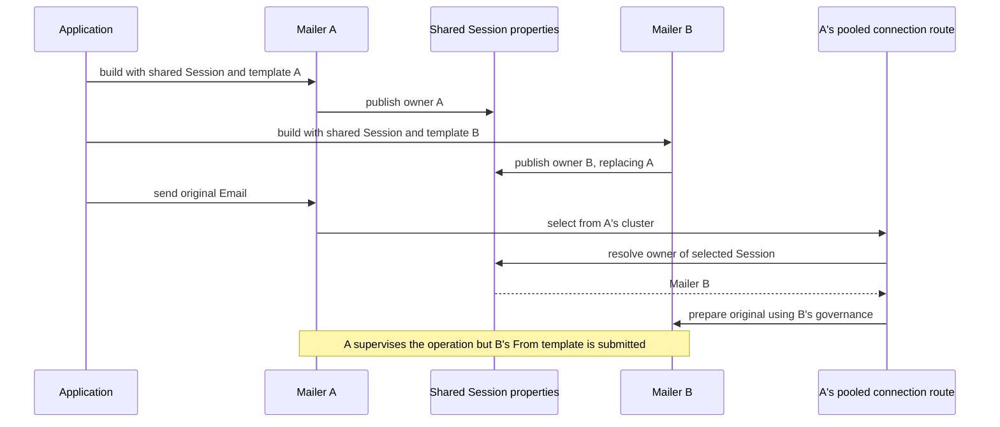

# Failover ownership seam code review

[Failover documentation](README.md) · [Architecture and review seams](architecture.md#11-deeper-implementation-review-seams)

Reviewed on **12 October 2026**, against the current `codex/10.0.0` working-tree implementation after checkpoint `0594624f822809b22a4c9d0f23b435281eeab22e`, including the authenticated-proxy and cancellation/cleanup follow-up. Scope: the six critical seams in the architecture guide, with static tracing through SJM, Generic Object Pool, Clustered Object Pool and SMTP Connection Pool.

**Original review result: one confirmed P2 finding.** The other five seams produced no additional actionable finding in that pass. The finding existed before the later recovery-state refactor. The original review applied no production fix; the ownership correction and its subsequent verification are recorded below.

## Finding: preserve the owner of a caller-supplied Session

**P2 — A second accepted Mailer can silently replace the first Mailer's selected message governance.**

Entry points in the original implementation: `MailerImpl.publishConfiguredSessionOwner()`, [`MailerImpl.selectedOwner()`](../../modules/simple-java-mail/src/main/java/org/simplejavamail/mailer/internal/MailerImpl.java), and [`MailConnectionRoute.visitSelectedCandidateOnce()`](../../modules/simple-java-mail/src/main/java/org/simplejavamail/mailer/internal/MailConnectionRoute.java). The publisher has since been replaced by early ownership claiming.

Building B around A's caller-supplied Jakarta Mail Session is accepted when neither configuration has locks. B's construction unconditionally writes a new `SessionOwner` into that Session's properties. A subsequent ordinary pooled send through A selects its registered Session, resolves B from that mutable property, and prepares the original Email with B's templates and validator. A's observer and operation still supervise the send. No explicit failover relationship or connection failure is needed to trigger this mismatch.

The public-API reproduction uses two Mailers with distinct cluster keys, one shared Session and different From overrides. It sends through A once before constructing B and once afterwards:

```text
Expected both sends through A: owner-a@example.test
Actual before constructing B: owner-a@example.test
Actual after constructing B:  owner-b@example.test
```

The assertion that constructing B must leave A's From template unchanged fails. The original Email has no From, so the result tests selected governance directly rather than caller-provided header precedence. A deterministic Jakarta Mail recording transport captures the prepared message at provider invocation; this reproduction does not send to a live SMTP account.

The original controls both passed:

- Separate Sessions with independent Properties preserve A's From override with pooling present.
- The same shared Session preserves A's From override when batch and all pool artifacts are removed from the runtime classpath.

These controls isolate the failure to resolving the selected Mailer through the mutable Session owner association. The existing `verifySessionCanBeConfigured()` guard rejects Session sharing only when configuration locks are involved, so it does not enforce unique ownership for this accepted case. Sender identity, templates and validation must not change merely because another Mailer is constructed.



**Recommended correction:** retain an immutable Mailer sending context with the selected registration, or reject conflicting Session ownership before changing its converter, properties or pool registration. An ownership check performed after `configureSendingSession()` would be too late to leave A's context untouched. Add a public regression for two no-lock Mailers sharing a Session, including ordinary sync/async pooled sending; cover failed second construction and shared Properties if the chosen ownership rule handles those cases.

## Seam coverage

| Seam | Review and exercised contracts | Outcome |
| --- | --- | --- |
| Claim context → explicit observation → usable handoff | Traced fresh claim identity and narrowed budgets through all pool layers; checked scoped observer association retirement, healthy reuse, cancelled handoff and capacity waiting. `ClaimObservationOwnershipTest`, `AcquiredConnectionObservationTest` and public pool contracts passed. | No additional finding. |
| Observation generation → visit cancellation → recovery transition | Reviewed once-only publication, independent/background observations, overlapping success/failure, replacement visits, policy isolation and per-visit backoff. Deterministic ownership/recovery tests and public recovery contracts passed. | No additional finding. |
| Common scope → transport/proxy/reservation/participant cleanup | Reviewed partial construction, setup disposal before continuation, exact escaping exceptions, callback-handled send failures, lease health, authenticated-proxy prerequisites and participant shutdown. Provider, proxy, scope and internal lifecycle regressions passed. | No additional finding. |
| Preparation → acquisition-only routing → submission | Confirmed preparation is outside the continuation catch and provider/MIME work follows route return. Reviewed security precedence, credential-provider failures and cancellation evidence during failed cleanup. Public provider, SMTP, TLS and wire regressions passed. | No additional finding. |
| Selected registration → Email governance and allowance | Reviewed selected templates, traversed locks, original Email reuse and allowance ownership. Existing selected-preparation tests passed; the additional Session-sharing reproduction exposed mutable selected-owner crossover. | **P2 finding above.** |
| Ordinary scope → retained batch/callback lifetime | Reviewed lazy iteration, between-email recovery, pinned callbacks, current-email cancellation control, retained pool capacity, sender confinement and replacement cleanup. Public scope and internal failover regressions passed. | No additional finding. |

## Original review verification

The review compiled **16 current changed production files** into isolated output: two in core, two in batch and twelve in the main module. It also compiled the selected current test sources and the public reproduction using **JDK 11.0.16.1**, targeting Java 11. The dependency/test classpath came from the project's existing Surefire report; each selected regression suite ran in a separate JVM. Compilation and execution used ignored `target/failover-seam-review` outputs and did not format or modify production/test sources.

**182 tests passed across 16 suites**, with zero failures, skips or aborted tests:

| Suite | Passed |
| --- | ---: |
| `ConnectionRecoveryTest` | 19 |
| `ConnectionRecoveryOwnershipTest` | 14 |
| `AcquiredConnectionObservationTest` | 3 |
| `DestinationConnectionObserverTest` | 4 |
| `SelectedMailerPreparationTest` | 3 |
| `ConnectionFailoverTest` | 62 |
| `ScopedMailSenderTest` | 3 |
| `SmtpConnectionFailoverWireTest` | 4 |
| `FailoverProviderContractTest` | 12 |
| `FailoverPoolContractTest` | 6 |
| `FailoverScopeContractTest` | 15 |
| `FailoverRecoveryContractTest` | 4 |
| `FailoverSmtpContractTest` | 24 |
| `FailoverProxyContractTest` | 3 |
| `FailoverTlsContractTest` | 4 |
| Batch `ClaimObservationOwnershipTest` | 2 |

The additional reproduction is deliberately separate from that passing-suite total: shared Session plus pooling fails its ownership assertion; independent Sessions plus pooling and shared Session without pool artifacts both pass.

Local reproduction source, compile/run helpers, classpaths and logs are retained under `target/failover-seam-review/`, including:

- `SharedSessionProbe.java`, `compile-current.ps1`, `run-focused.ps1` and `compile.log`.
- `shared-session-probe.log`, `separate-session-control.log` and `shared-session-direct-control.log`.
- `focused-run.log`, `focused-results.json` and `suite-counts.json`, plus one log per suite.

This pass did not repeat the full reactor, Java 21 lane, upstream suites, Postfix/Exim conformance or Spring/CLI matrices. Their dated evidence remains in the [state-refactor verification record](../research/755-failover-state-refactor-verification.md). The pool-free execution here is the ownership control, not a rerun of the complete child-process contract suite.

The report's Mermaid sequence and relative links were validated. At the end of the original review the finding remained open; no commit, push, dependency publication or external review comment was made.

## Correction: reject duplicate live Session ownership

The maintainer accepted rejection instead of wider independently owned sending contexts. `MailerImpl.claimSessionOwnership()` now atomically reserves the actual Session Properties object before configuring the Session, converter, proxy or pool. Different factories and different Sessions sharing that same Properties object cannot claim another live owner. Rejected construction leaves the first owner's configuration and pool untouched.

Successful construction rollback or completed graceful shutdown retires only that owner's exact token and converter. Starting shutdown does not release ownership while accepted sends still need it. Failed cleanup retains the guard; callers should use a fresh Session rather than replace a potentially active context. Reuse after successful completed shutdown is supported, and repeating an old owner's close cannot retire a replacement.

This is a deliberate compatibility change against earlier releases, not merely a correction to unreleased routing. The canonical builder Javadoc, current configuration guide and **10.0.0 migration notes** explain reusing one concurrent Mailer or creating independent Sessions with independent Properties from the original SMTP settings. ADR 0029, the plan and lifecycle/pool/failover concurrency contracts record the accepted ownership boundary. The shared infographic's resource layers are unchanged.

### Correction regressions and evidence

The original ownership rejection regression failed in both sync and async pooled modes before production changes: construction unexpectedly accepted the second Mailer. That red evidence is retained in `target/755-session-ownership/red-tests-restored.log`. The first two build attempts did not provide test evidence: automatic license formatting encountered a Windows mapped-file error and left four previously unchanged files empty. Their committed contents were restored; subsequent test builds disable automatic license formatting. Final header cleanup and integrity checks remain separate verification steps.

`MailerSessionOwnershipTest` adds 12 cases for sync/async pooled governance isolation, no pre-rejection property/debug/proxy mutation, independent Sessions, different Sessions sharing Properties, library-created Sessions, construction interleaving, successful failed-build rollback, unresolved pool cleanup, completed shutdown reuse and retained ownership while sends drain. Its direct-send control disables optional batch availability; the separate existing pool-free contract suite still runs in genuinely pool-free JVMs. Existing sending-limit tests now use independent Sessions without weakening their allowance, cancellation, batch or callback assertions.

Fresh Java 11.0.16.1 library `verify` passed **463 parent invocations across 42 suites**, including all 12 new ownership cases, plus **61 pool-free child scenarios**, with no failures/errors/skips. Classpath/JPMS consumers passed. A forced Javadoc refresh also confirmed the new contract in the generated builder HTML rather than relying on a cached Javadoc artifact.

The modern-JDK all-tests reactor initially ran 2,015 cases through the main module and exposed five older fixtures that deliberately built concurrent owners around one Session. Four trust-reconfiguration cases now close each previous owner first, retaining every existing trust/identity assertion. The minimal-constructor case now asserts duplicate rejection and inspects independent runtime contexts without unpriming live Sessions. All 14 cases in those two targeted selections passed after the fixture corrections. Subsequent successful reactor verification completed Spring/starter and CLI tests, regenerated both CLI caches, and reran remaining integration/cache suites. Combined coverage is **2,260 passing cases across 214 suites**, plus the existing disabled performance case, and all 61 pool-free child scenarios. This is an initial full selection followed by corrected-fixture and integration completion runs, not a claim of one uninterrupted green all-tests invocation.

Website checks passed all 84 cases, the clean build succeeded, and internal-link verification checked 3,949 local links across 66 pages. All 39 current concurrency/architecture Mermaid diagrams parsed and rendered. The updated documentation's relative links/anchors also passed. The coding-guide audit found no need for another state machine or sending-context abstraction: the exact construction token and existing lifecycle drain fence this ownership boundary. Single-worker `mvn license:remove` succeeded; normalized source hashes matched across all 681 Java files, with no generated headers or empty files left. The four formatter-damaged files match their committed contents, including original EOF formatting.

**Finding resolved in the working tree.** The original red reproduction remains historical evidence; the current API rejects the duplicate build before it can change A's templates, converter, proxy settings or pool registration. After this correction, the ownership/publication, failed-construction, draining-shutdown and resource-retirement paths were retraced without another actionable finding in this scope. Logs, copied reports and source-integrity evidence are retained under `target/755-session-ownership/`.

These correction-verification commands used locally verified unpublished pool SNAPSHOTs with `-Denforcer.skip=true`, before the separately approved [supporting-library cascade](../research/755-failover-state-refactor-verification.md#authorized-supporting-library-cascade-12-october-2026). Subsequent SJM verification passed against the published chain with dependency enforcement enabled. No live-email tests, benchmarks or SpotBugs were run. The maintainer subsequently accepted the corrections and authorized [selective local commit delivery](../plans/755-smtp-connection-failover.md#local-commit-delivery-12-october-2026); pushing and GitHub closure remain separate. Unrelated maintainer documentation, staged artwork and concurrent website/Journal work are preserved.
