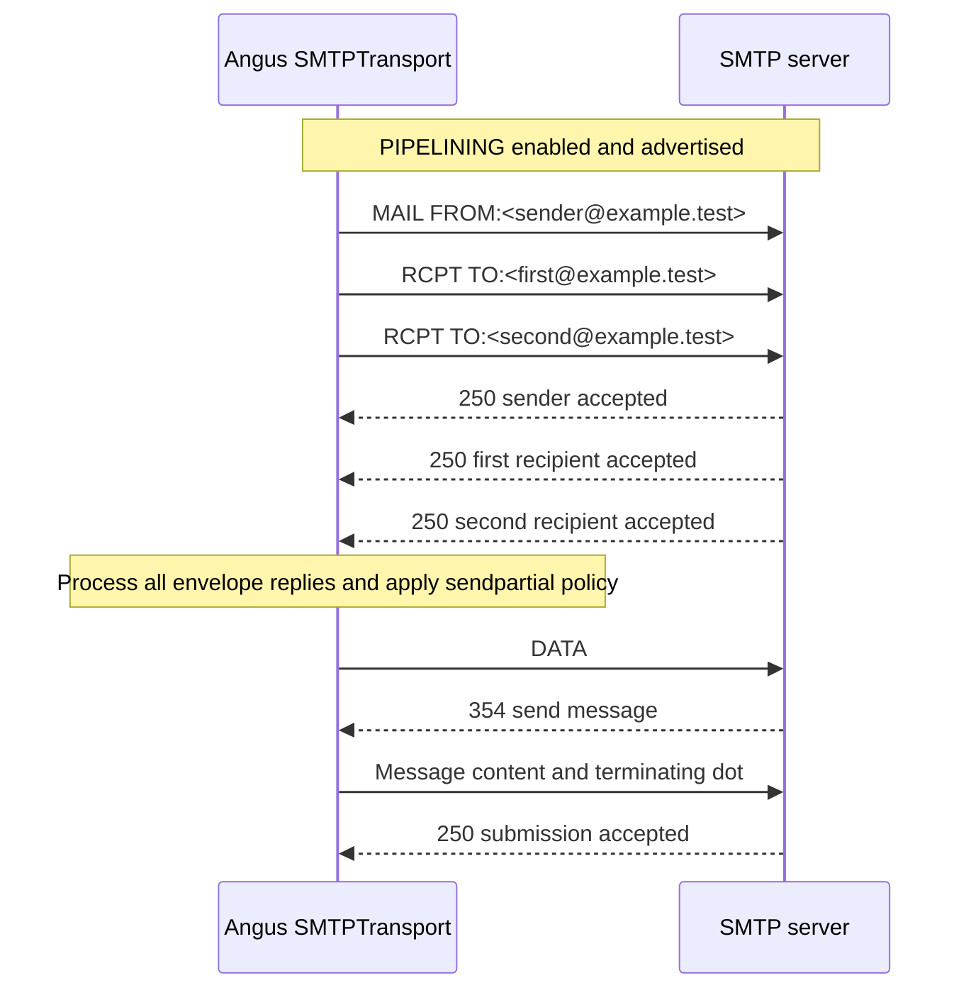

# Proposal: opt-in SMTP envelope PIPELINING

Posted as a [comment in Angus Mail #213](https://github.com/eclipse-ee4j/angus-mail/issues/213#issuecomment-6127724727) on 2026-10-12, without these local notes or the internal research link. Related Simple Java Mail work: [#699](https://github.com/bbottema/simple-java-mail/issues/699). Local [code and contribution review](../research/699-angus-pipelining-proposal-review.md).

## What this proposal is for

This is a scope and behavior proposal for discussion with the Angus maintainers before I start coding. It defines what the first contribution would support, how it would be enabled, which existing behavior must not change, and what I would test.

It is not a complete implementation design. Details such as the command queue, response bookkeeping, read/write loop, and any changes needed around protected hooks are deliberately left for the local prototype. If that work uncovers a choice that affects the agreed behavior or Angus's public or protected API, I will bring it back for discussion before opening the implementation PR.

## Purpose and first contribution

After the BDAT fix in [#210](https://github.com/eclipse-ee4j/angus-mail/pull/210), I would like to add opt-in envelope PIPELINING to Angus. PIPELINING reduces SMTP round trips by sending several commands before waiting for their replies. The difference is most noticeable on higher-latency connections and for messages with several recipients.

For a first contribution, I propose pipelining only `MAIL FROM` and `RCPT TO`. Angus would read and process every envelope reply before issuing `DATA` or sending the first BDAT chunk. The existing DATA and BDAT paths can then continue as they do today.

To keep the first change manageable, it would not pipeline the DATA command, change how BDAT chunks are scheduled, add BINARYMIME, or pipeline across separate message transactions.

## Configuration

I propose Boolean Session properties following [Angus's SMTP property conventions](https://eclipse-ee4j.github.io/angus-mail/docs/api/org.eclipse.angus.mail/org/eclipse/angus/mail/smtp/package-summary.html) and [Jason's request for a feature toggle](https://github.com/eclipse-ee4j/angus-mail/issues/213#issuecomment-6086528787):

| Property | Default |
| --- | --- |
| `mail.smtp.pipelining` | `false` |
| `mail.smtps.pipelining` | `false` |

Turning the property on would allow PIPELINING, not require it. Only a successful EHLO on the current connection that advertises PIPELINING may enable it. After STARTTLS or reconnecting, Angus must discard earlier capabilities and check again. Failed EHLO, missing PIPELINING, HELO fallback, or a disabled property means sequential sending. The TLS reset follows [RFC 3207, section 4.2](https://www.rfc-editor.org/rfc/rfc3207.html#section-4.2). These names and defaults are proposed; I do not propose a separate "require PIPELINING" setting.

## Command sequence

This is the intended flow for a small group of envelope commands. Larger envelopes need a bounded window because a server may start replying while Angus is still sending commands.

With CHUNKING, Angus also waits for and checks all `MAIL FROM` and `RCPT TO` replies before sending the first BDAT chunk.

## Implementation and compatibility

I propose using the existing SMTP provider and connection, with [`Transport.sendMessage` staying synchronous](https://github.com/eclipse-ee4j/angus-mail/blob/a7bd3fed964d9c9bc2981d4b2c9867358453c571/providers/smtp/src/main/java/org/eclipse/angus/mail/smtp/SMTPTransport.java#L1242). No new runtime dependency, public asynchronous API, or connection pool is planned.

Both paths should use the same code to build commands and handle replies. Angus must match each command to its complete reply in order, including multiline replies, and keep the response details it exposes today. Each command must still pass the existing validation before being grouped.

Envelope parameters, `sendpartial`, `reportsuccess`, recipient arrays, exception chains, and transport events must keep their existing meaning. A rejected `MAIL FROM` remains the primary failure; replies to RCPT commands already sent must not label recipients invalid merely because the sender was rejected.

Angus [supports subclasses through protected methods](https://github.com/eclipse-ee4j/angus-mail/blob/a7bd3fed964d9c9bc2981d4b2c9867358453c571/providers/smtp/src/main/java/org/eclipse/angus/mail/smtp/SMTPTransport.java#L80). Today, `mailFrom()` waits for its reply and `rcptTo()` handles recipients one at a time. The disabled path should keep that behavior. With PIPELINING enabled, overrides assuming immediate replies may need adapting. I will test those cases and agree any hook changes with the maintainers.

When the server rejects an envelope command and the connection is still usable, Angus must read the replies to the other commands it already sent before issuing RSET. It may reuse the connection once the replies and reset are complete. A `421` shutdown reply, disconnect, timeout, or malformed reply should close the connection. It should not automatically replay the transaction.

Backpressure is the part that needs some care. Angus needs limits for queued command bytes and replies still to come. Those limits alone do not prevent deadlock: [RFC 2920](https://www.rfc-editor.org/rfc/rfc2920.html#section-3.1) also requires nonblocking operation or groups that fit within the TCP window. The prototype must establish a safe read/write strategy for both plain SMTP and TLS before I treat the approach as ready. With CHUNKING, [RFC 3030](https://www.rfc-editor.org/rfc/rfc3030.html#section-2) requires Angus to process every envelope reply before sending BDAT.

## Focused validation and delivery

I would extend Angus's existing [`SMTPHandler` and `TestServer` fixtures](https://github.com/eclipse-ee4j/angus-mail/blob/a7bd3fed964d9c9bc2981d4b2c9867358453c571/providers/angus-mail/src/test/java/org/eclipse/angus/mail/smtp/SMTPHandler.java) to cover:

- The property being on or off, servers without PIPELINING, reconnects, HELO fallback, and changed or failed EHLO responses after STARTTLS.
- Commands being sent before earlier replies arrive, replies arriving in order, multiline replies, and unchanged DATA and BDAT handling.
- Sender rejection, some or all recipients being rejected, both `sendpartial` settings, `reportsuccess`, and unusual recipient reply codes. Delivery results and events should follow the existing rules.
- `421`, disconnects, timeouts, malformed replies, backpressure, protected-method overrides, and safe connection reuse after a rejection and reset.

I would also run the existing tests and [Angus's Maven verification on JDK 11, 17, and 21](https://github.com/eclipse-ee4j/angus-mail/blob/a7bd3fed964d9c9bc2981d4b2c9867358453c571/.github/workflows/maven.yml). First show that envelope commands reach the server before their preceding replies; a small latency comparison can follow if useful. I would document the property in `smtp/package-info.java` and add release or compatibility notes where needed.

Once this proposal is agreed, I will prototype it in Angus, update Simple Java Mail's command and reply tracking to understand the pipelined flow, and test the combination locally before opening the Angus implementation PR.

## Questions for maintainers

1. Does this envelope-only scope, disabled by default, fit Angus?
2. What behavior should existing protected-method overrides retain when PIPELINING is enabled?
3. Which Angus branch and release should I target?
